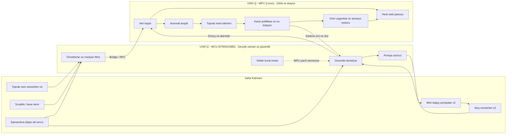
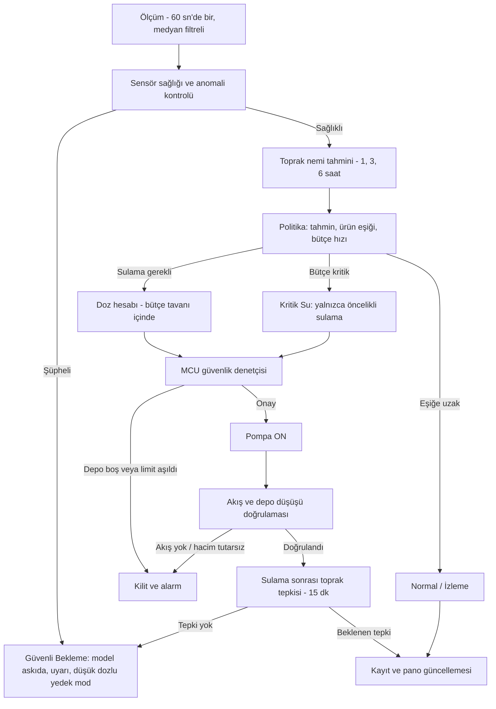
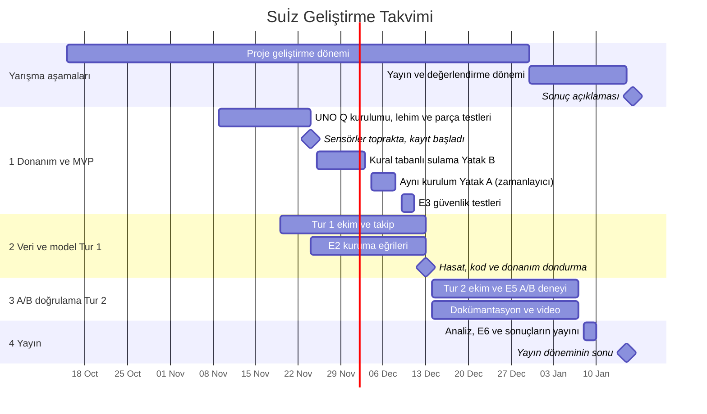

<div align="center">

# 🌱 Suİz

### Su Bütçesi Kısıtlı, Edge AI Destekli, Kapalı Döngülü Akıllı Sulama Karar Sistemi

**Arduino® UNO™ Q** üzerinde çalışan; sulama kararını üreten, fiziksel olarak uygulayan ve sonucunu sensörlerle doğrulayan tarımsal karar destek prototipi

`Arduino UNO Q Türkiye İnovasyon Proje Yarışması` · `Kategori: Yapay Zekâ` · `İkincil odak: Sosyal ve Çevresel Etki`

</div>

> **Kaynak notu:** Projenin güncel bilgisi (durum, takvim, kurulum, bağlantı şeması) tek yerde tutulur: [proje sitesi](https://berceste-team.github.io/Su-z/) (kaynağı bu depodaki `docs/`). Bu README ve [docs/donanim-plani.md](docs/donanim-plani.md) ayrıntılı teknik kayıttır ve siteyle aynı karar ve tarihleri içerir. Notion yalnızca görev tahtası için kullanılır (kurallar için [AGENTS.md](AGENTS.md)).

---

## 📋 Proje Kartı

| | |
| :--- | :--- |
| **Platform** | Arduino® UNO™ Q (STM32U585 MCU + Qualcomm® Dragonwing™ QRB2210 MPU) |
| **Kategori** | Yapay Zekâ *(ikincil: Sosyal ve Çevresel Etki)* |
| **Fiziksel prototip ölçeği** | 2 adet 0,24 m² test yatağı (60 × 40 cm), toplam 0,48 m² |
| **Örnek tarla ölçeği** | 1 dekar (1000 m²), mm tabanlı dijital ikiz / senaryo motoru ile |
| **Geliştirme dönemi** | 15 Ekim – 30 Aralık 2026 |
| **Doğrulama** | A/B deneyi: Suİz ve zamanlayıcı tabanlı geleneksel sulama; hızlı döngülü model bitkiler (turp / roka, 3–4 hafta) |
| **Yayın** | GitHub, Arduino Project Hub ve maker.robotistan.com (yayın penceresi: 30 Aralık 2026 – 15 Ocak 2027) |
| **Durum** | 21 Kasım 2026: parçalar teslim alındı ve 16 Kasım'da parçadan doğrulandı; MOSFET kartları lehimlendi ve devrenin elektrik bağlantıları kuruldu. Henüz güç verilmedi, hiçbir parça test edilmedi; yataklar hazırlanıyor. Deney takvimi 15 Ocak 2027'ye kadar uzar (§9.2, §11) |
| **Güncel takip** | [Proje sitesi](https://berceste-team.github.io/Su-z/) tek veri kaynağıdır; görevler Notion tahtasında tutulur, bkz. yukarıdaki not ve [AGENTS.md](AGENTS.md) |

## 📑 İçindekiler

1. [Özet](#1-özet)
2. [Problem Tanımı ve Odak Alanı](#2-problem-tanımı-ve-odak-alanı)
3. [Çözüm Yaklaşımı ve Temel Katkılar](#3-çözüm-yaklaşımı-ve-temel-katkılar)
4. [Ölçek ve Test Düzeni](#4-ölçek-ve-test-düzeni)
5. [Sistem Mimarisi](#5-sistem-mimarisi)
6. [Donanım](#6-donanım)
7. [Yazılım, Yapay Zekâ ve Karar Mekanizması](#7-yazılım-yapay-zekâ-ve-karar-mekanizması)
8. [Güvenlik ve Hata Yönetimi](#8-güvenlik-ve-hata-yönetimi)
9. [Doğrulama Metodolojisi ve Deney Tasarımı](#9-doğrulama-metodolojisi-ve-deney-tasarımı)
10. [Beklenen Çıktılar](#10-beklenen-çıktılar)
11. [Proje Geliştirme Takvimi ve Kilometre Taşları](#11-proje-geliştirme-takvimi-ve-kilometre-taşları)
12. [Riskler ve Yedek Planlar](#12-riskler-ve-yedek-planlar)
13. [Sosyal ve Çevresel Etki](#13-sosyal-ve-çevresel-etki)
14. [Depo Yapısı, Durum ve Lisans](#14-depo-yapısı-durum-ve-lisans)
15. [Kaynaklar](#15-kaynaklar)

---

## 1. Özet

Sulamada klasik yaklaşım, toprak nemi bir eşiğin altına düştüğünde pompayı çalıştırmaktır. Su kaynağı kısıtlı olduğunda bu yaklaşım yetersiz kalır: sulama kararı yalnızca "toprak şu an ne kadar kuru?" sorusuna değil, **"eldeki su sezonun kalanına nasıl yetecek?"** sorusuna da bağlı olmalıdır.

**Suİz**, bu soruyu cihaz üzerinde yanıtlayan fiziksel bir karar destek sistemidir. Arduino UNO Q'nun iki işlemcisini birlikte kullanır: gerçek zamanlı ve güvenlik açısından kritik işler MCU'da, yapay zekâ çıkarımı ve karar mantığı Linux tarafında (MPU) çalışır. Sistem şu döngüyü sürekli işletir:

```text
Ölç → Doğrula → Tahmin Et → Karar Ver → Uygula → Sonucu Doğrula
```

- **Ölç:** Toprak nemi (iki derinlik), toprak ve ortam sıcaklığı, hava nemi, güneş radyasyonu (hava durumu servisinden), depo hacmi (akış sensöründen hesaplanır).
- **Doğrula:** Sensör verisi, karar sürecine girmeden önce fiziksel ve istatistiksel tutarlılık kontrolünden geçer.
- **Tahmin Et:** Model, toprak neminin önümüzdeki saatlerdeki seyrini tahmin eder.
- **Karar Ver:** Politika; tahmini, ürünün su ihtiyacını ve **kalan su bütçesini** birlikte değerlendirir.
- **Uygula:** MCU pompayı, güvenlik sınırları içinde çalıştırır.
- **Sonucu Doğrula:** Su akışı, depo hacmi ve sulama sonrası toprak tepkisi ile kararın gerçekten uygulanıp uygulanmadığı kontrol edilir.

Sistem; kuru çalışmayı, tıkanıklığı, sensör arızasını ve bağlantı kaybını fiziksel olarak tespit eder ve güvenli duruma geçer. Ek olarak, FAO yöntemlerine dayanan bir **ürün uygunluk ve senaryo (what-if) motoru**, kullanıcıya "su bütçem %20 azalırsa hangi kararlar değişir?" sorusunun yanıtını sunar.

Doğrulama, tohumdan hasada 3–4 hafta süren hızlı döngülü model bitkilerle (turp / roka), 0,24 m²'lik iki kontrollü test yatağında **zamanlayıcı tabanlı geleneksel sulamaya karşı** A/B testiyle yapılır. Karar katmanı bütçeyi **mm (L/m²)** biriminde tuttuğu için ölçekten bağımsızdır; aynı motor 1 dekarlık örnek bir tarla için de çalıştırılabilir.

### English Summary

**Suİz** is a closed-loop, water-budget-aware irrigation decision system running on the **Arduino UNO Q**. The real-time **STM32 MCU** handles sensing, pump control and hardware-level safety interlocks; the **Linux MPU** runs a lightweight on-device ML model that forecasts root-zone soil moisture, a residual-based anomaly detector for sensor trust, and a budget-aware decision policy. Every irrigation decision is verified physically through flow measurement, tank level and post-irrigation soil response. A FAO-based crop-suitability and what-if engine works in millimetres of water, so it is scale-independent. The prototype is validated on two controlled 0.24 m² test beds with fast-cycle model crops (radish / rocket) in an A/B test (Suİz vs. a tuned timer baseline) and evaluated with a 1-decare virtual field. All results, including negative ones, will be reported transparently on Arduino Project Hub.

---

## 2. Problem Tanımı ve Odak Alanı

Tarımsal üretimde kullanılan tatlı su kaynaklarının hızla tükenmesi, üreticileri sınırlı su bütçeleriyle en yüksek verimi almaya zorlamaktadır. Küresel ölçekte tatlı su çekimlerinin yaklaşık %70'i tarımsal sulamada kullanılmaktadır (FAO AQUASTAT); Türkiye'de de sulama, toplam su kullanımının en büyük kalemidir.

Mevcut otomatik sulama sistemleri çoğunlukla tek derinlikli sabit eşik değerlerine ya da kör zamanlayıcılara dayanmaktadır. Bu yaklaşım sahada dört temel aksaklık yaratır:

1. **Sensör sapmaları ve hatalı tetikleme:** Bozulan veya kayan sensör verisi gereksiz sulamaya ya da bitkinin susuz kalmasına yol açar.
2. **Doğrulamasız aktüasyon:** Pompa arızası, boru tıkanması veya hat patlaması durumunda sistem sulama yapıldığını varsayar.
3. **Bütçe ve tahmin eksikliği:** Gelecek saatlerdeki buharlaşma/terleme (ET) eğilimi ve depoda kalan toplam su hacmi karar anında hesaba katılmaz.
4. **Bulut bağımlılığı:** Kırsal alanlarda internet kesintisi yaşandığında bulut tabanlı sistemler işlevini yitirir.

Suİz, tüm bu süreçleri internet bağlantısı gerektirmeyen, kendi içinde doğrulamalı yerel bir Edge AI mimarisiyle ele alır.

---

## 3. Çözüm Yaklaşımı ve Temel Katkılar

Suİz'in yenilik iddiası tek bir özellikte değil, üç ilkenin **tek bir fiziksel döngüde** birleşmesindedir:

### 💧 Katkı 1 — Su bütçesi kısıtlı karar
Sulama politikası, kalan su bütçesini ve kalan gün sayısını kullanarak **bütçe hızı** hesaplar. Yalnızca "toprak kuru mu?" değil, "bu sulamayı şimdi yapmak sezonun kalanını riske atar mı?" sorusuna göre karar verir. Su azaldığında sistem kademeli olarak **Kritik Su** moduna geçer ve yalnızca öncelikli sulama yapar.

### 🔐 Katkı 2 — Güvenilir veri ve doğrulanmış uygulama
Karar üç yerde doğrulanır: **girdi** (sensör sağlığı ve anomali kontrolü), **eylem** (pompa açıldıktan sonra su akışı ve depo düşüşü), **etki** (sulama sonrası toprak neminin beklenen tepkisi). Kritik güvenlik kuralları (kuru çalışma kilidi, azami çalışma süresi) MCU üzerinde, yapay zekâdan bağımsız çalışır.

### 🧠 Katkı 3 — Açıklanabilir, yerel Edge AI
Model çıkarımı, karar politikası ve pano cihazın kendi Linux ortamında çalışır; temel işlevler internet gerektirmez. Her karar; girdileri, tahmini, bütçe durumu ve güven skoruyla birlikte gösterilir.

### 🌾 Karar destek katmanı — Ürün uygunluğu ve senaryolar
Bu üç çekirdek katkının üzerine, aynı bütçe mantığını kullanan bir **ürün uygunluk ve what-if motoru** eklenir (bkz. [7.7](#77-ürün-uygunluk-ve-senaryo-motoru)). Bu katman kesin bir "şu ürünü ek" emri vermez; FAO yöntemine dayalı **karşılaştırmalı göreli verim tahminleri** üretir.

### Kapsam sınırları

Suİz'in ne olmadığını açıkça belirtmek, iddiaların doğrulanabilir kalması için önemlidir:

- Gerçek bir tarlada denenmiş bir ürün **değildir**; prototip 0,24 m²'lik test yataklarında doğrulanır (bkz. [Bölüm 4](#4-ölçek-ve-test-düzeni)).
- Ürün uygunluk skoru **verim garantisi** değildir; sezonluk, yaklaşık bir su-verim ilişkisine dayanır.
- Kamera tabanlı bitki analizi, uydu verisi ve çok tarlalı yönetim çekirdek kapsamın dışındadır (bkz. [Bölüm 13](#13-sosyal-ve-çevresel-etki)).

---

## 4. Ölçek ve Test Düzeni

Gerçek bir tarlada test yapmak bu yarışmanın süresi ve mevsimi içinde mümkün değildir. Suİz bu nedenle **iki katmanlı bir ölçek stratejisi** kullanır: kapalı döngü fiziksel donanımla küçük ölçekte doğrulanır, karar katmanı ise ölçekten bağımsız bir birimle tasarlanır.

### 4.1 Neden milimetre?

Tarımsal su bütçesi litre yerine **mm** cinsinden ifade edilir:

```text
1 mm su = 1 L/m²
```

Kök bölgesindeki su dengesi birim alan başına belirlenir. Bu yüzden 0,24 m²'lik bir yatakla 1000 m²'lik bir tarlanın bütçesi aynı birimde karşılaştırılabilir. Litre karşılığı yalnızca alan çarpılarak bulunur.

| | Fiziksel prototip (yatak başına) | Örnek tarla (dijital ikiz) |
| :--- | :--- | :--- |
| **Alan** | 0,24 m² (60 × 40 cm) | 1 dekar = 1000 m² |
| **1 mm su** | 0,24 L | 1000 L |
| **Rolü** | Kapalı döngüyü fiziksel olarak doğrulamak | Karar ve senaryo motorunu tarla ölçeğinde göstermek |
| **Ölçek oranı** | Örnek tarlanın yaklaşık 1/4000'i | — |

### 4.2 Fiziksel test yatakları

| Özellik | Değer |
| :--- | :--- |
| **Yatak sayısı** | 2 (Yatak A: kontrol, Yatak B: Suİz). Bütçe ve zaman elverirse 3. yatak: Yatak C (kısıtlı bütçe) |
| **Kasa boyutu** | 60 × 40 cm, derinlik ≈ 20 cm, toprak derinliği ≈ 15 cm |
| **Bitki** | Turp (*Raphanus sativus*) veya roka (*Eruca vesicaria*): tohumdan hasada 3–4 hafta süren hızlı döngülü model bitkiler. İki yatakta aynı tür ve aynı ekim yoğunluğu |
| **Sulama hattı** | Yatak başına bir gözenekli / damlatıcılı sulama hattı, ayrı pompa ve ayrı depo |
| **Depo** | Yatak başına 20 L (bütçe hesabı ve kuru çalışma testleri için) |
| **Sensörler (yatak başına)** | 2 korozyona dayanıklı kapasitif toprak nem sensörü (kök bölgesi ≈ 5 cm, süzülme bölgesi ≈ 10 cm), akış sensörü, şamandıra (depo hacmi akış sensöründen hesaplanır) |
| **Ortam** | Kapalı alan, balkon veya cam önü; ışık yetersizse LED bitki lambası. Ortam sıcaklık/nem sensörü iki yatak için ortaktır; güneş radyasyonu Open-Meteo'dan alınır |

İki derinlikte sensör bulunması yalnızca ölçüm zenginliği değil, aynı zamanda **çapraz doğrulama** sağlar: sulamadan sonra üst sensör alttan önce tepki vermelidir; bu ilişki bozulursa sensör şüpheli işaretlenir.

### 4.3 Prototip su bütçesi

Prototipte bütçe **Tur 2 (E5) deneyinin 24 günü** için tanımlanır. İç mekânda bitki su tüketiminin yaklaşık 1–3 mm/gün aralığında olacağı varsayılmıştır; bu değer E2 (kuruma eğrisi) deneyleriyle kalibre edilecektir.

| Senaryo | Bütçe (24 gün) | Litre (0,24 m² yatak) | Günlük ortalama |
| :--- | :--- | :--- | :--- |
| Normal | 50 mm | 12,0 L | ≈ 2,1 mm/gün |
| %20 kısıtlı | 40 mm | 9,6 L | ≈ 1,7 mm/gün |
| %40 kısıtlı | 30 mm | 7,2 L | ≈ 1,3 mm/gün |

Tek bir sulama olayı yaklaşık 0,3–1,2 L (≈ 1,25–5 mm) hacmindedir; 1–2 L/dk debili bir mini pompa ile yaklaşık 10–50 saniyelik bir çalışmaya karşılık gelir. Kontrol yatağının (Yatak A) zamanlayıcı dozu (günde iki kez yaklaşık 1 mm), bitkiyi strese sokmayacak şekilde **normal bütçeye yakın** ayarlanır (adil bir kontrol, "kasıtlı kötü" bir baz çizgisi değildir). Suİz ise sabit takvime değil, gerçek tüketime göre daha seyrek ve daha büyük dozlarla sulama yapabilir.

### 4.4 Deney grupları

| Grup | Sulama yöntemi | Amaç |
| :--- | :--- | :--- |
| **Yatak A (kontrol)** | Ayarlanmış zamanlayıcı: günde iki kez sabit doz | Yaygın uygulamayı temsil eder |
| **Yatak B (Suİz)** | Bütçe tavanı 50 mm; kararlar model + politika ile | Suİz'in su kullanımı ve bitki gelişimi üzerindeki etkisi |
| **Yatak C (opsiyonel)** | Suİz, bütçe tavanı 40 mm | Kısıtlı bütçede karar davranışı |

### 4.5 Ölçeğin sınırlılıkları

Küçük ölçek dürüstçe raporlanması gereken sınırlar getirir:

- Bir yatak, tarladaki **mekânsal değişkenliği** (toprak heterojenliği, damla hattı boyunca basınç kaybı) temsil etmez.
- Her grupta tek yatak bulunduğundan sonuçlar **istatistiksel anlamlılık iddiası taşımaz**; prototip düzeyinde karşılaştırmalı gösterimdir.
- Kısa süreli bir deneme, sezon boyu su stresi etkilerini kapsamaz.

**Ölçek büyütme yolu:** Gerçek bir tarlada her sulama vanası bir **bölgedir** ve Suİz'in karar birimi bölgedir. Prototipteki yatak, bir bölgenin küçük ölçekli karşılığıdır. Karar katmanı mm biriminde çalıştığı için bölge büyüdüğünde yalnızca hidrolik donanım (pompa, vana, boru çapı) değişir; politika ve model mantığı aynı kalır.

---

## 5. Sistem Mimarisi

UNO Q, tek kart üzerinde iki işlemci barındırır: Linux çalıştıran **Qualcomm Dragonwing QRB2210 (MPU)** ve gerçek zamanlı **STM32U585 (MCU)**. İkisi Arduino'nun **Bridge (RPC)** kütüphanesiyle haberleşir. Suİz bu ayrımı bilinçli olarak kullanır: **güvenlik ve gerçek zaman MCU'da, zekâ ve arayüz MPU'da** çalışır.



### 5.1 Sorumluluk dağılımı

| Katman | Görev | Neden burada? |
| :--- | :--- | :--- |
| **MCU (STM32U585)** | Sensör örnekleme ve filtreleme; pompa sürme; azami çalışma süresi; şamandıra ile donanımsal düşük seviye kilidi; akış doğrulama zamanlayıcısı; MPU heartbeat izleme; yedek kural modu | Deterministik zamanlama ve **Linux çökse bile pompanın güvenli kalması** |
| **MPU (Linux)** | Veri kaydı (SQLite/CSV); özellik çıkarımı; anomali tespiti; toprak nemi tahmini; karar politikası; su bütçesi; ürün uygunluk ve senaryo motoru; yerel web panosu | Python ekosistemi, yeterli bellek ve işlem gücü |
| **Bridge (RPC)** | MCU → MPU: ham ölçümler, olaylar, alarmlar. MPU → MCU: sulama izni ve doz | Arduino'nun resmi MCU–MPU haberleşme yolu |

**Kritik tasarım kararı:** Yapay zekâ pompayı doğrudan sürmez; yalnızca MCU'daki güvenlik denetçisine **istek** iletir. Denetçi isteği; depo seviyesi, azami süre, asgari bekleme aralığı ve günlük hacim tavanı kurallarına göre onaylar veya reddeder.

### 5.2 Karar akışı



---

## 6. Donanım

Aşağıdaki liste, iki yataklı çekirdek prototip içindir. Elektronik kalemler yarışmanın sağladığı 50 USD'lik çekle **Robotistan'dan** alınır. Kasa, toprak, tohum, depo ve hortum gibi kalemler yerel olarak karşılanır. Ürün adları, fiyatlar, pin planı ve hazırlık takvimi için bkz. **[docs/donanim-plani.md](docs/donanim-plani.md)**.

| Bileşen | Adet | Teknik rolü |
| :--- | :---: | :--- |
| **Arduino® UNO™ Q** (2 GB veya 4 GB) | 1 | MCU + MPU: sensör okuma, pompa kontrolü, Edge AI, pano |
| **Korozyona dayanıklı kapasitif toprak nem sensörü** (analog, 3,3–5,5 V) | 4 (+2 yedek) | Yatak başına iki derinlikte (kök bölgesi ≈ 5 cm, süzülme bölgesi ≈ 10 cm) toprak nemi. *Robotistan'da kapasitif model bulunmadığından dışarıdan (Robocombo) alındı; gelen kart v2.0 (HW-390)* |
| **Sıcaklık / nem sensörü** (DHT22 modülü) | 1 (+1 yedek) | Ortam koşulları; VPD ve ET₀ hesabı |
| **Düşük debili akış sensörü** (YF-S401, 0,3–6 L/dk, Hall etkili) | 2 (+1 yedek) | Sulama sırasında gerçek su akışının ve hacminin ölçümü; depo hacmi de bundan hesaplanır |
| **Mini DC dalgıç pompa** (6 V, 120 L/sa) | 2 (+2 yedek) | Depoya daldırılmış, yatak başına sulama; 5 V hattan beslenir |
| **Opto-izoleli MOSFET sürücü** (LR7843) + flyback diyot (1N5819) | 2 (+1 yedek) | Pompaların güvenli sürülmesi; kontrol tarafının güç hattından yalıtılması. Kart üç klemenslidir (−, LOAD, +): pompa + ile LOAD arasına bağlanır, kart pompanın eksi tarafını anahtarlar |
| **Şamandıra (float) anahtarı** (dik tip, Robotistan ürün kodu 18584) | 2 (+1 yedek) | Yazılımdan bağımsız, donanımsal düşük seviye kilidi. Su varken kontak kapalı olacak şekilde takılır: tel koparsa "su yok" okunur ve pompa kilitlenir |
| **5 V 2 A DC adaptör** | 1 | Pompa ve akış sensörü hattı. UNO Q, USB-C şarj aletinden ayrı beslenir |
| **1000 µF 16 V elektrolitik kondansatör** | 2 | 5 V pompa hattında, MOSFET kartlarının yanında; pompa açılışındaki gerilim düşüşünün analog nem okumalarını bozmasını önler |
| **Depo, 20 L** (ışık geçirmeyen, kapaklı, litre işaretli) | 2 | Bütçeli su kaynağı |
| **Bitki yatağı kasası** (≈ 60 × 40 × 20 cm, drenaj delikli), toprak, tohum | 2 | Test yatakları |
| **Sulama hattı** (4×6 mm silikon hortum, çekvalf, T-parça, delikli hortum) | 2 set | Kontrollü su uygulaması |
| Breadboard, pertinaks, klemens, jumper ve montaj kablosu, makaron, gerilim bölücü dirençler | — | Deneme, kalıcı kurulum ve bağlantı |
| Şeffaf kapaklı termoplastik buat (280 × 210 × 74 mm) | 1 | Elektronik kutusu (ilk plandaki saklama kabının yerine) |
| Toprak sıcaklık sensörü (DS18B20, su geçirmez) *(opsiyonel)* | 2 | Kapasitif sensörlerin sıcaklık düzeltmesi |
| Yük hücresi + HX711 *(opsiyonel)* | 2 | Depo ağırlığından bağımsız hacim çapraz doğrulaması |

**Sadeleştirme notu (20 Ekim 2026):** İlk plandaki ultrasonik seviye sensörleri (HC-SR04), ışık sensörü (TEMT6000), 12 V adaptör + LM2596 ve proje kutusu çıkarıldı. Depo hacmi zaten birincil ölçüm olan akış sensöründen hesaplanır, alt sınırı şamandıra korur. Güneş radyasyonu ve ET₀ Open-Meteo'dan alınır; internet yoksa sıcaklığa dayalı Hargreaves yöntemi kullanılır. Gerekçeler: [docs/donanim-plani.md §5](docs/donanim-plani.md#5-sadeleştirme-ve-gerekçeleri).

**Donanım tasarım notları**

- Islak ortamda çalışıldığı için tüm güç hatları **düşük gerilimli DC** (UNO Q için 5 V USB-C, pompa ve sensörler için ayrı 5 V adaptör) olarak tasarlanır. Şebeke gerilimi su hattından ayrı tutulur ve topraklı, kaçak akım korumalı priz kullanılır.
- Pompa motor yükü için flyback diyot (kartın + ve LOAD klemensleri arasında, çizgili ucu +'da) ve ayrı besleme hattı kullanılır; iki beslemenin GND'si birleştirilir (akış darbesinin okunabilmesi için şart).
- UNO Q'nun MCU tarafı 3,3 V mantıktadır ve A0–A5 girişlerine 3,3 V üstü uygulanmaz. Robotistan'da seviye dönüştürücü bulunmadığından 5 V çıkışlı akış darbe sinyallerine dirençli gerilim bölücü (10k/20k) konur. Kapasitif sensörlerin çıkışı 0–3 V olduğundan bölücü gerekmez.
- Kapasitif sensörler her yatak toprağı için **iki noktalı kalibrasyon** (kuru/doygun) ve gravimetrik kontrol ile kalibre edilir. Kart kenarları ve elektroniği nemden korunur.
- YF-S401'in ölçüm aralığı (0,3–6 L/dk) pompa debisini kapsar. Litre başına darbe sayısı satıcıya göre değiştiğinden mezürle kalibre edilir ve E3 deneyinde doğrulanır.
- **Hacim doğrulamasında akış sensörü birincildir.** Depo hacmi akıştan hesaplanır, her dolumda bidon işaretleriyle elle sıfırlanır; alt sınır kilidi şamandıradadır.
- Prototip balkonda (Adana) çalışır. Yağmur ölçülmeyen bir su girdisi olduğundan yataklar ve depolar yağmurdan korunur (saçak, şeffaf örtü veya mini sera); elektronik kutusu (şeffaf kapaklı buat) yağmur ve doğrudan güneş almayan yere konur.

---

## 7. Yazılım, Yapay Zekâ ve Karar Mekanizması

**Teknoloji yığını:** MCU tarafında Arduino C/C++ (Zephyr üzerinde Arduino çekirdeği); MPU tarafında Python 3.x (veri işleme, model, karar, pano); geliştirme ve dağıtım için Arduino App Lab; model tarafında scikit-learn tabanlı hafif modeller (gerekirse ONNX Runtime); yerel kayıt için SQLite/CSV; pano için hafif bir Python web çerçevesi.

### 7.1 Veri hattı

| Aşama | Ayrıntı |
| :--- | :--- |
| **Örnekleme (MCU)** | Her 60 saniyede bir; her sensör için 9 örneğin medyanı. Sulama sonrası 15 dakika boyunca 30 saniyede bir |
| **Aktarım** | Bridge (RPC) üzerinden MPU'ya ölçüm, olay ve alarm paketleri |
| **Özellik çıkarımı (MPU)** | 10 dakikalık pencereler; model ve politika her 10 dakikada bir çalışır |
| **Kayıt** | Her karar için: girdiler, tahmin, güven skoru, durum, doz, doğrulama sonucu ve gerekçe |

**Model girdileri**

| Grup | Özellikler |
| :--- | :--- |
| Toprak | Hacimsel nem (kök bölgesi ve süzülme bölgesi), 1 ve 3 saatlik değişim hızı, toprak sıcaklığı |
| Ortam | Hava sıcaklığı, bağıl nem, VPD (türetilmiş), güneş radyasyonu ve ET₀ (Open-Meteo) |
| Sulama geçmişi | Son sulamadan geçen süre, son doz (mm), son 24 saatte toplam su |
| Zaman ve ürün | Günün saati (sin/cos), ekimden geçen gün, ürün profili |

### 7.2 Toprak nemi tahmin modeli

Model, yakın gelecekte toprak neminin nasıl seyredeceğini tahmin eder:

```text
Girdi  : son ölçümler + ortam + sulama geçmişi + zaman/ürün
Çıktı  : θ(t+1 sa), θ(t+3 sa), θ(t+6 sa)  →  "sulama olmazsa kuruma eğrisi"
Türev  : sulama eşiğine kalan süre (τ)
```

- **Aday modeller:** (1) kalıcılık / doğrusal ekstrapolasyon baz çizgisi, (2) Ridge / ARX, (3) gradyan artırma (ör. HistGradientBoosting), (4) küçük MLP.
- **Seçim ölçütü:** Zaman bazlı çapraz doğrulama (veri sızıntısını önlemek için rastgele değil, kronolojik ayırma). Ölçütler: 1/3/6 saat ufkunda MAE ve RMSE; karar açısından "eşiğe kalan süre" hatası.
- **Doz hesabı** yapay zekâya bırakılmaz; kök bölgesi su dengesi ile şeffaf biçimde yapılır:

```text
Doz (mm) = (θ_hedef − θ_şimdi) × Z_r        Z_r: etkin kök bölgesi derinliği (mm)
```

Sulama sonrası gözlenen toprak tepkisi, bu formüldeki etkinlik katsayısını (sızma/dağılım kayıplarını) çevrimiçi olarak kalibre eder.

### 7.3 Eğitim verisi ve dürüst raporlama

Kısa geliştirme süresi nedeniyle veri iki kaynaktan oluşur:

1. **Gerçek veri:** E2 (kuruma eğrisi) deneyleri ve Tur 1 boyunca yataklardan toplanan ölçümler.
2. **Sentetik veri:** Kök bölgesi su dengesi simülatöründen üretilen veri; farklı hava koşulları, gürültü ve sensör arızaları içerir. Ön eğitim, veri artırma ve anomali enjeksiyonu için kullanılır.

```text
θ(t+1) = θ(t) + [ I(t) + P(t) − ETc(t) − D(t) ] / Z_r
I: sulama · P: yağış · ETc: bitki su tüketimi · D: derin sızma
```

**Kural:** Model performansı **yalnızca gerçek veriden ayrılmış test setinde** raporlanır. Sentetik verinin rolü ve sınırı Project Hub sayfasında açıkça belirtilir.

### 7.4 Sensör güvenilirliği ve anomali tespiti

Tek bir sensör değerine körü körüne güvenilmez. Sistem, klasik ve öğrenilmiş kontrolleri katmanlı kullanır:

| Kontrol | Yöntem | Yakalanan durum |
| :--- | :--- | :--- |
| Aralık | Kalibrasyon aralığı dışındaki değerler | Kopuk kablo, kısa devre |
| Değişim hızı | Saatlik en büyük fiziksel değişim sınırı | `%21 → %22 → %23 → %91 → %24` gibi sıçramalar |
| Donma (flatline) | Uzun süre birebir aynı değer | Takılı kalmış sensör |
| Çapraz tutarlılık | Kök bölgesi ve süzülme bölgesi sensörlerinin tepki sırası ve ilişkisi | Tek sensörün kayması |
| **Tahmin artığı** | Ölçüm ile model tahmini arasındaki fark, sağlam (robust) z-skor ile | Model beklentisine uymayan ölçümler |
| Sulama sonrası tepki | Sulamadan sonra 15 dakika içinde beklenen artış | Tıkanık hat, sensör temassızlığı |

Her sensör için **sağlık skoru** (0–1) üretilir. Skor düşük olduğunda veri karar sürecine alınmaz; sistem **Güvenli Bekleme** durumuna geçer (bkz. 7.5). Bu katmanların bir kısmı bilinçli olarak klasik sinyal işlemedir: basit, denetlenebilir kurallar ile öğrenilmiş artık analizi birlikte kullanılır. Tahmin artığı temelli kontrol, karşılaştırma amacıyla Isolation Forest ile de denenecektir.

### 7.5 Karar politikası ve su bütçesi

Politika, tahmini, ürün profilindeki eşikleri ve kalan bütçeyi birleştirir:

```text
bütçe_hızı (mm/gün) = kalan_bütçe (mm) / kalan_gün
```

Sulama; şu koşulların **tümü** sağlandığında istenir:

1. Tahmine göre toprak nemi, sulama eşiğine 3 saat içinde ulaşacaktır (veya ulaşmıştır).
2. Sensör sağlığı ve güven skoru yeterlidir.
3. Son 72 saatte verilen su + planlanan doz ≤ 1,5 × 3 × bütçe_hızı (72 saatlik kayan pencere).
4. Depo seviyesi güvenli aralıktadır.

**Karar durumları**

| Durum | Koşul (özet) | Eylem |
| :--- | :--- | :--- |
| 🟢 **Normal** | Sulama eşiğine ≥ 12 saat var | İzle, kaydet |
| 🟡 **İzleme** | Eşiğe 3–12 saat var | Ölçüm ve tahmin sıklığını artır |
| 🔵 **Sulama** | Eşiğe ≤ 3 saat, güven yeterli, bütçe uygun | Doz hesapla, MCU denetçisine istek gönder |
| 🟠 **Kritik Su** | Bütçe hızı, beklenen su ihtiyacının %70'inin altında veya depo düşük | Yalnızca kritik eşik altında ve azaltılmış hedefle (kıt su sulaması) |
| ⚪ **Güvenli Bekleme** | Sensör şüpheli veya güven düşük | Model askıya alınır, uyarı verilir, MCU düşük dozlu yedek moda geçebilir |
| 🔴 **Kilit** | Depo boş, akış yok veya limit aşıldı | Pompa kapatılır, alarm; kullanıcı müdahalesi gerekir |

Eşikler ve katsayılar başlangıç değerleridir; E1–E3 deneylerinde kalibre edilir.

### 7.6 Karar güveni ve açıklanabilir pano

**Güven skoru** üç bileşenin çarpımıdır:

```text
güven = model_belirsizlik_skoru × min(sensör_sağlığı) × kapsam_skoru
```

- *Model belirsizliği:* Model topluluğunun (ensemble) veya kuantil tahminlerinin aralık genişliğinden.
- *Kapsam skoru:* Girdilerin eğitim dağılımı içinde olup olmadığı.
- Bu skor kalibre edilmiş bir olasılık **değildir**; test setinde güvenilirlik diyagramı ile kontrol edilir ve pano üzerinde "karar güveni" olarak sunulur.

Yerel web panosu, her kararı gerekçesiyle gösterir:

```text
🔵 SULAMA ÖNERİLDİ — Yatak B

Toprak nemi (üst / alt)   : %27 / %31 (ort. %29)   Sulama eşiği : %30
3 saat sonra tahmin      : %25                    Kritik eşik  : %22
Sıcaklık / Hava nemi     : 24 °C / %41            Hedef nem    : %33
Son sulama               : 31 saat önce           VPD          : yüksek
Önerilen doz             : 4,0 mm (0,96 L)   [ (%33 − %29) × Z_r 100 mm ]
Bütçe                    : 31,2 / 50 mm kaldı · bütçe hızı 1,6 mm/gün · hız normal
Depo seviyesi            : %68
Karar güveni             : %88
```

### 7.7 Ürün uygunluk ve senaryo motoru

Bu katman, bütçe mantığını "hangi ürün bu su ile ne kadar verim verir?" sorusuna genişletir. Yöntem, FAO'nun yayımlanmış su–verim ilişkisine (FAO Irrigation and Drainage Paper 33) dayanır:

```text
1 − Ya/Ym = Ky × (1 − ETa/ETm)
```

- **ETm:** Ürünün tam su ihtiyacı (referans buharlaşma × ürün katsayısı Kc; FAO-56 yöntemi ile). Referans buharlaşma FAO-56 (Penman-Monteith tabanlı) yaklaşıma dayanır; prototipte yerel sıcaklık/nem ölçümü ile Open-Meteo'nun radyasyon ve ET₀ verisinden hesaplanır. İnternet yoksa yalnızca sıcaklığa dayanan Hargreaves yöntemine (FAO-56) geçilir.
- **ETa:** Bütçenin karşılayabildiği gerçek su tüketimi (ETa ≤ ETm; bütçe fazlaysa ETa = ETm).
- **Ky:** Ürüne özgü verim tepkisi katsayısı.
- **Ya/Ym:** Göreli verim tahmini, uygunluk skoru olarak sunulur.

**Girdiler:** alan (m²), su bütçesi (L veya mm), sezon uzunluğu, ürün profilleri (Kc, Ky, ETm) ve yerel ölçümlerden buharlaşma tahmini. **Çıktı:** ürün başına göreli verim tahmini, kullanılmayan su ve bütçe riski.

**Örnek hesap** (ürün parametreleri varsayımsaldır; gerçek değerler FAO-56 / FAO-33 tablolarından alınacaktır). Örnek tarla: 1 dekar; normal bütçe 450 mm (= 450 m³/dekar):

| Ürün | ETm (mm) | Ky | Normal bütçe (450 mm) | %20 azalma (360 mm) | %40 azalma (270 mm) |
| :--- | :---: | :---: | :---: | :---: | :---: |
| Ürün A (yüksek su ihtiyacı) | 600 | 1,25 | %69 | %50 | %31 |
| Ürün B (orta) | 450 | 1,05 | %100 | %79 | %58 |
| Ürün C (düşük) | 300 | 0,90 | %100 | %100 | %91 |

Bütçe azaldıkça hiçbir ürünün göreli verim tahmini artmaz; sıralama ve kararlar ise değişir. Kullanıcı senaryo panelinde yalnızca su bütçesini değiştirerek **"Su miktarım azalırsa hangi kararlar değişir?"** sorusunu yanıtlar. Motor aynı zamanda mm biriminde çalıştığı için hem 0,24 m²'lik prototip yatağı hem de 1 dekarlık örnek tarla için çalıştırılabilir.

**Sınırlılıklar:** İlişki sezonluk ve yaklaşıktır; büyüme evrelerine göre değişen su duyarlılığı ve toprak/iklim farkları hesaba katılmaz. Skor bir **karar destek göstergesidir**, verim garantisi değildir. Motorun su kullanımı tahmini, E5 deneyinde ölçülen gerçek su kullanımıyla karşılaştırılarak doğrulanır.

---

## 8. Güvenlik ve Hata Yönetimi

Tasarımın amacı yalnızca doğru karar üretmek değil, **yanlış kararların fiziksel sonuçlarını sınırlamaktır.** Kritik kurallar MCU'da, yapay zekâdan bağımsız çalışır.

| Risk | Önlem | Katman |
| :--- | :--- | :---: |
| Sensör hatalı veri üretir | Katmanlı anomali kontrolü + sağlık skoru + Güvenli Bekleme | MPU |
| Sensör bağlantısı kopar | Aralık ve donma kontrolü, alarm, yedek moda geçiş | MCU + MPU |
| Model düşük güvenli | Güven < eşik ise politika askıya alınır, kullanıcı uyarılır | MPU |
| Pompa çalışır ama su akmaz | Açılıştan sonra 3 sn içinde akış darbesi yoksa pompa durdurulur; art arda 2 başarısız denemede kilit | MCU |
| Hortum kaçağı / tıkanıklık | Verilen hacim / hedef hacim oranı 0,8–1,2 dışında ise uyarı; sulama sonrası toprak tepkisi yoksa uyarı | MCU + MPU |
| Depo boşalır | Şamandıra ile **donanımsal** kilit + yazılım eşiği (%10) | MCU (donanım) |
| Aşırı sulama | Tek olay ≤ 60 sn, olaylar arası ≥ 20 dk, 72 saatlik bütçe penceresi | MCU |
| MPU (Linux) donar veya çöker | Heartbeat 60 sn kaybolursa pompa kapanır; MCU sınırlı hacimli yedek kural moduna geçer | MCU |
| İnternet kesilir | Ölçüm, karar, kayıt ve pano tamamen yerel çalışır | MPU |
| Elektrik kesintisi | Pompa açılışta varsayılan olarak KAPALI; bütçe durumu güç geldiğinde kalıcı kayıttan yüklenir | MCU + MPU |
| Model yetersiz kalır | Model, politikaya girmeden önce baz çizgisine karşı doğrulanır; yetersizse fizik/kural tabanlı politika kullanılır ve bu durum raporlanır | Süreç |
| Su/elektrik güvenliği | Yalnızca 5 V DC, topraklı ve kaçak akım korumalı priz, şebeke gerilimi su hattından ayrı | Donanım |

---

## 9. Doğrulama Metodolojisi ve Deney Tasarımı

Prototipin başarısı yalnızca model doğruluğuyla değil, **kararın fiziksel dünyada doğru uygulanması ve bitki/su sonucuyla** değerlendirilir.

**Model bitki seçimi.** Dar takvim aralığında (3–4 hafta) tohumdan hasada tüm vejetatif ve yaprak gelişim evrelerini tamamlayabilen hızlı döngülü bitkiler seçilmiştir: turp (*Raphanus sativus*) veya roka (*Eruca vesicaria*).

**Karşılaştırmalı A/B düzeneği.**
- **Kontrol grubu (Yatak A):** Geleneksel tarımda yaygın kullanılan, sabit zaman aralıklı ve tek eşikli zamanlayıcı kontrolü.
- **Deney grubu (Yatak B):** Suİz dinamik bütçe optimizasyonu ve çift derinlikli tahminleme kontrolü.

**Fiziksel doğrulama zinciri.** Her sulama döngüsü üç aşamalı olarak teyit edilir:

```text
Pompa tetikleme → Akış darbesi (hacim) → Δ Toprak nemi tepkisi
```

Depo hacmi akış sensörünün saydığı hacimden hesaplanır ve her dolumda bidon üzerindeki litre işaretleriyle elle doğrulanır. Depo alt sınırı şamandırayla donanımsal olarak korunur.

### 9.1 Deney seti

| Kod | Deney | Dönem | Amaç | Çıktı |
| :--- | :--- | :--- | :--- | :--- |
| **E1** | Sensör kalibrasyonu | Tarih netleşecek (sensörler toprağa girmeden önce, 24 Kasım'a kadar) | İki noktalı (kuru/doygun) ve gravimetrik kalibrasyon | Kalibrasyon eğrileri, ölçüm belirsizliği |
| **E2** | Kuruma eğrisi (dry-down) | 24 Kasım – 13 Aralık (sensörler toprağa girdikten sonra) | Tur 1 yataklarında, çimlenme öncesi (fiilen bitkisiz) ve bitkili dönemde, sulamalar arasında; farklı sıcaklık/nem/ışık altında toprak neminin doğal azalışı; ET aralığının kalibrasyonu | Model eğitim verisi, gerçek ET aralığı |
| **E3** | Aktüatör ve güvenlik testleri | 9–11 Aralık | Kuru çalışma kilidi, akış yok, hortum kesme, MPU heartbeat kaybı, elektrik kesintisi | Geçti/kaldı tablosu, debi doğrulaması |
| **E4** | Anomali enjeksiyonu | Tarih netleşecek (dondurmadan önce) | Sensör sökme, sıçrama, donma, sentetik bozulma | Yakalama oranı, yanlış alarm sayısı |
| **E5** | A/B sulama deneyi (Tur 2) | 14 Aralık – 7 Ocak (24 gün) | Suİz (Yatak B) ile ayarlanmış zamanlayıcının (Yatak A) karşılaştırılması | Su kullanımı, nem kararlılığı, bitki gelişimi |
| **E6** | Senaryo motoru doğrulama | 8–10 Ocak | Senaryo motorunun tahmin ettiği su kullanımının E5'te ölçülenle karşılaştırılması | MAPE / sapma |

### 9.2 İki tur yaklaşımı

- **Tur 1 (19 Kasım – 13 Aralık):** İlk ekim 19 Kasım'da. Ekim sensörlerden bağımsızdır; sistem kurulana kadar iki yatak mezürle ölçülen eşit hacimlerle elle sulanır ve kaydedilir. Nem sensörleri ve DHT22 24 Kasım'a kadar toprağa girer ve ölçümler kaydedilir. **Kural tabanlı** sulama 3 Aralık'a kadar Yatak B'de uçtan uca çalışır (pompa, akış, şamandıra, kilitler); aynı kurulum 8 Aralık'a kadar Yatak A'da zamanlayıcı moduyla tamamlanır. Güvenlik testleri (E3) 9–11 Aralık'ta yapılır. Suİz modeli Tur 1'de **gölge modunda** çalışır: kararlarını üretir ve kaydeder ancak pompayı sürmez; başlangıç tarihi netleşecek. Tur 1 hasadı 13 Aralık'tadır. Tur 1 aynı zamanda ikinci ekim için yedek ve çimlenme kontrolüdür.
- **Tur 2 (14 Aralık – 7 Ocak, 24 gün):** Yataklar 13 Aralık'ta boşaltılır, toprak karıştırılıp nemi eşitlenir ve yeni ekim yapılır. Model v1 devrededir; **kod ve donanım 13 Aralık'ta donmuştur**. A/B deneyi (E5) bu turda yürütülür. Analiz ve sonuçların yayını 8–10 Ocak'tadır.

> **Takvim notu (16 Kasım 2026):** Takvim 15 Ocak 2027'ye, yani yarışmanın yayın döneminin sonuna kadar uzatıldı. Önceki plan (Tur 1: 15 Kasım – 3 Aralık, dondurma 3 Aralık, Tur 2: 4–27 Aralık, yayın 30 Aralık) geçerliliğini yitirdi: kurulum gecikti, ekim 19 Kasım'a kaydı. Sonuç olarak A/B deneyi yayın penceresinin (30 Aralık – 15 Ocak) içinde biter ve sonuçlar 8–10 Ocak'ta yayımlanır; pencerenin kapanmasına yalnızca 5 gün kalır, bu risk bilinerek alınmıştır. Daha önceki takvim notu (9 Kasım 2026): özgün plan 5 Kasım – 1 Aralık idi ve Tur 1 kısaltılmıştı.
>
> **Sensör notu (16 Kasım 2026):** Kapasitif toprak nem sensörleri (v2.0, HW-390, 6 adet) teslim alındı ve parçadan doğrulandı: tek parça bıçak, üç pin (GND, VCC, AOUT). Ayrıca elde dirençli tip (iki bacaklı çıplak metal çatal) sensörler de var; bunlar toprakta paslandığı için deneyde kullanılmaz. Toprağa girmeden önce kart kenarlarına şeffaf oje sürülecek.

### 9.3 Ölçütler

**Teknik**
- Sensör kararlılığı (tekrarlı ölçüm standart sapması) ve kalibrasyon hatası
- Akış sensörü hacim doğruluğu (ölçülen hacim / mezürle ölçülen hacim)
- Güvenlik kilitlerinin güvenilirliği
- Anomali yakalama oranı ve yanlış alarm sayısı
- İnternet olmadan temel işlevlerin devamı

**Yapay zekâ / karar**
- 1, 3 ve 6 saat ufkunda MAE ve RMSE; baz çizgisine göre iyileşme
- Sulama eşiğine kalan süre (τ) tahmin hatası
- Güven skorunun güvenilirlik diyagramı ile kontrolü
- Gölge modda model kararı ile uygulanan karar arasındaki uyum

**Sistem ve bitki (E5)**
- Toplam uygulanan su (L ve mm) ve sulama olayı sayısı
- Hedef nem aralığında kalma oranı, su stresi süresi (saat)
- Sulama olaylarının fiziksel doğrulanma oranı
- Biyokütle artışı (hasatta taze ağırlık, mümkünse kuru ağırlık), çimlenme oranı ve **su kullanım verimliliği (WUE, g biyokütle / L su)**

### 9.4 Hedef ölçütleri

Aşağıdaki değerler **tasarım hedefleridir**; sonuçlar hedefin altında kalsa da olduğu gibi raporlanacaktır.

| Alan | Hedef |
| :--- | :--- |
| Kuru çalışma kilidi, akış yok alarmı, heartbeat kaybı | Her biri için 10 denemede 10 doğru tepki |
| Anomali enjeksiyonu (sıçrama, donma, kopma) | Yakalama ≥ %90; yanlış alarm ≤ günde 1 |
| 3 saat ufkunda nem tahmini | Baz çizgisine göre MAE'de anlamlı iyileşme (hedef ≥ %15) |
| Sulama olaylarının doğrulanması | Uygulanan olayların ≥ %95'i akış ve tepki ile doğrulanmış |
| **Hipotez H1 (E5)** | Suİz, ayarlanmış zamanlayıcıya kıyasla **daha az su** ile **eşdeğer bitki gelişimi** sağlar (WUE ↑) |

### 9.5 Raporlama ilkeleri

- Ham veri, kod ve deney protokolleri açık paylaşılır.
- Model başarısı yalnızca gerçek veriden ayrılmış test setinde raporlanır; sentetik verinin rolü belirtilir.
- Yatak sayısı sınırlı olduğundan sonuçlar için istatistiksel anlamlılık iddia edilmez (bkz. [4.5](#45-ölçeğin-sınırlılıkları)).
- Beklenmeyen veya olumsuz sonuçlar da nedenleriyle birlikte yayımlanır.

---

## 10. Beklenen Çıktılar

1. **Donanım destekli çalışan prototip:** Yapay zekâ yazılımından bağımsız donanımsal emniyet katmanına (taşma ve kuru çalışma koruması) sahip, kapalı döngü sulama ünitesi.
2. **Deneysel karşılaştırma raporu:** Aynı biyokütle gelişimine ulaşmak için tüketilen su miktarının Suİz ile klasik yöntem arasındaki farkını (tasarruf yüzdesi) gösteren şeffaf veri seti. Sonuçlar olumlu ya da olumsuz olduğu gibi raporlanır.
3. **Yerel karar ve senaryo panosu:** Her sulama veya erteleme kararının gerekçesini, güven skorunu ve olası bütçe kesintisi senaryolarının yansımalarını gösteren, internet gerektirmeyen yerel arayüz.
4. **Açık kaynak proje paketi:** Devre şemaları, malzeme listesi (BOM), kaynak kodlar, sentetik simülatör betiği ve deney video kaydı; GitHub, Arduino Project Hub ve maker.robotistan.com üzerinde yayın.

---

## 11. Proje Geliştirme Takvimi ve Kilometre Taşları

Takvim, yarışmanın resmî aşamalarına göre kurgulanmıştır: başvuru 1 Ekim'de kapanır; ön değerlendirme ve kit gönderimi 1–15 Ekim; geliştirme **15 Ekim – 30 Aralık**; yayın ve değerlendirme **30 Aralık – 15 Ocak**; sonuçlar 16 Ocak 2027'de açıklanır. Proje takvimi 16 Kasım 2026'da 15 Ocak'a kadar uzatıldı: A/B deneyi yayın penceresinin içinde biter (gerekçe §9.2). Kart eline ulaşmadan önceki dönem simülasyon, veri hazırlığı ve malzeme temini için kullanılır.

### Fazlar

| Dönem | Faz | Temel görevler ve çıktılar |
| :--- | :--- | :--- |
| **Eylül – 8 Kasım** | **Hazırlık (plan gerisinde kalındı)** | Tasarım, donanım planı ve Robotistan siparişi |
| **9 Kasım – 8 Aralık** | **Donanım ve MVP** | UNO Q kurulumu, parçaların şemayla karşılaştırılması ve lehim, sensör kalibrasyonları (E1), MCU'da bağımsız acil güvenlik kilitleri; kural tabanlı sulama 3 Aralık'a kadar Yatak B'de, 8 Aralık'a kadar Yatak A'da (zamanlayıcı) uçtan uca |
| **19 Kasım – 13 Aralık** | **Veri toplama ve model (Tur 1)** | 1. tur model bitki ekimi (19 Kasım), sensörler toprakta (24 Kasım), gerçek kuruma eğrilerinin kaydedilmesi (E2), simülatör verisiyle birleştirilerek hafif ML modelinin eğitilmesi, modelin gölge modda denenmesi, anomali filtreleri, bütçe politikası, pano, senaryo motoru; güvenlik testleri (E3, 9–11 Aralık); 13 Aralık'ta hasat, kod ve donanım dondurma |
| **14 Aralık – 7 Ocak** | **A/B doğrulama deneyi (Tur 2)** | 2. tur ekim ile Suİz ve klasik zamanlayıcı karşılaştırma testi (24 gün), su tüketimi ve gelişim metriklerinin toplanması; dokümantasyon taslakları ve video çekimi paralel yürütülür |
| **8 – 15 Ocak** | **Belgelendirme ve yayın** | E6, deneysel sonuçların grafikleştirilmesi, proje videosu; 8–10 Ocak'ta GitHub, Arduino Project Hub ve maker.robotistan.com üzerinde açık kaynak dokümantasyon ve sonuç yayını; yayın dönemi 15 Ocak'ta biter |



### Kilometre taşları

| Kod | Tarih | Çıkış ölçütü |
| :--- | :--- | :--- |
| **M0** | Tarih netleşecek | UNO Q çalışıyor (16 Kasım: ilk program çalıştı); App Lab çalışıyor; MCU ve MPU arasında Bridge testi geçti |
| **M1** | 24 Kasım | Tüm sensörler MCU'dan okunuyor, Linux tarafında kaydediliyor; kalibrasyon eğrileri hazır |
| **M2 (MVP)** | 3 Aralık (Yatak B) · 8 Aralık (Yatak A) | Kural tabanlı sulama uçtan uca çalışıyor: pompa, akış doğrulama, depo kilidi, azami süre |
| **M3** | Tarih netleşecek (dondurmadan önce) | Model v1 (tahmin + anomali) gerçek test setinde baz çizgisine karşı raporlandı; pano ve senaryo motoru hazır |
| **M4** | 13 Aralık | Tur 1 hasadı; kod ve donanım donduruldu; Tur 2 (A/B, E5) 14 Aralık'ta başlar |
| **M5** | 7 Ocak | Deney ölçümleri tamamlandı |
| **M6** | 8–10 Ocak | Proje ve sonuçlar GitHub, Arduino Project Hub ve maker.robotistan.com'da yayında |

### Takvim ilkeleri

1. **Dondurma tarihi 13 Aralık'tır.** Sonrasında yalnızca güvenlik hataları düzeltilir; böylece deney tutarlı kalır ve dokümantasyon için zaman açılır.
2. **Dokümantasyon deneyle paralel yürür.** Proje metni, devre şeması, kod açıklamaları ve video, Tur 2 sürerken hazırlanır; deney bittiğinde (7 Ocak) yalnızca sonuçlar eklenir.
3. **Yayın penceresi etkileşim içindir.** 30 Aralık – 15 Ocak arasında görüntülenme ve beğeni toplanır. Deney 7 Ocak'ta bittiği için sonuçlu yayın 8–10 Ocak'ta yapılır; etkileşim için kalan süre kısadır ve bu bilinen bir ödünleşimdir.
4. **Kapsam kesme sırası** (gecikme halinde): Yatak C → yük hücresi → OLED → Isolation Forest karşılaştırması → E6. Kapalı döngü (MVP), güvenlik katmanı ve E5 deneyi asla kesilmez.

---

## 12. Riskler ve Yedek Planlar

| Risk | Olasılık / etki | Önlem ve yedek plan |
| :--- | :---: | :--- |
| **Kart geç teslim edilir** | Orta / Yüksek | Hazırlık dönemindeki simülatör ve veri hattı karttan bağımsızdır. Gerekirse sensör ve pompa katmanı eldeki bir Arduino ile prototiplenir, MPU tarafı bilgisayarda çalıştırılır; kart geldiğinde taşınır |
| **Gerçek veri yetersiz kalır** | Orta / Orta | Sentetik veri ile ön eğitim; fizik tabanlı özellikler; model baz çizgisini geçemezse fizik/kural tabanlı politika kullanılır ve bu durum raporlanır |
| **Bitki gelişmez / kış ışığı yetersiz** | Orta / Yüksek | LED bitki lambası; Tur 1 çimlenme kontrolü ve ikinci deneme fırsatı verir; turp ↔ roka geçişi, yedek olarak tere |
| **Sensör kayması ve kalibrasyon hatası** | Yüksek / Orta | İki noktalı + gravimetrik kalibrasyon; haftalık kontrol; iki derinlikte çapraz doğrulama; sıcaklık düzeltmesi |
| **Akış sensörü düşük debide hatalı** | Orta / Orta | Düşük debiye uygun sensör; E3'te debi doğrulaması; her dolumda bidon işaretleriyle elle hacim kontrolü ve isteğe bağlı yük hücresi ile çapraz kontrol |
| **Bütçe/zaman aşımı** | Orta / Orta | Kapsam kesme sırası (Bölüm 11); MVP'nin M2'de tamamlanması |
| **Wi-Fi/bağlantı sorunu** | Düşük / Düşük | Tüm işlevler yerel; pano yerel ağ üzerinden erişilir. Open-Meteo'ya ulaşılamazsa ET₀ yerel sıcaklıkla (Hargreaves) hesaplanır |
| **Elektrik/su güvenliği** | Düşük / Yüksek | 5 V DC, kaçak akım korumalı priz, su hattından ayrı kablolama |
| **Sonuçlar hipotezi desteklemez** | Orta / Düşük | Sonuçlar olduğu gibi raporlanır; neden analizi yapılır (gölge mod ve kayıtlar bunu mümkün kılar) |

---

## 13. Sosyal ve Çevresel Etki

Suİz'in hedefi, tarımsal su kullanımının **veriye dayalı ve doğrulanabilir** biçimde yönetilmesine düşük maliyetli, yerel çalışan bir araç sunmaktır.

- **Su kullanım verimliliği:** Sabit takvim veya tek eşik yerine gerçek tüketime göre sulama, gereksiz suyu azaltmayı hedefler. Sağlanan tasarruf miktarı önceden iddia edilmez; **E5 deneyi sonuçlarıyla raporlanır.**
- **Kıtlık dönemlerine hazırlık:** Bütçe hızı ve senaryo motoru, üreticiye "su azalırsa ne olur?" sorusunu ekimden önce sorma imkânı verir.
- **Bağlantıdan bağımsızlık:** Temel işlevlerin cihaz üzerinde çalışması, bağlantının zayıf olduğu kırsal alanlar için uygundur.
- **Erişilebilirlik:** Sensörler ve pompa, yaygın ve düşük maliyetli bileşenlerden oluşur; tasarım ve kod açık paylaşılacağı için küçük üreticiler, seralar, ev bahçeleri, okul ve topluluk bahçeleri tarafından uyarlanabilir.
- **Eğitsel değer:** Açıklanabilir karar ekranı, kullanıcının sulama mantığını öğrenmesini de sağlar.

**Ölçeklenebilirlik yolu:** Çok bölgeli (multi-zone) yapı, uzun menzilli haberleşme (ör. LoRa) ve güneş enerjisi ile beslenen saha düğümleri, çekirdek sistem doğrulandıktan sonra değerlendirilecek geliştirmelerdir.

### Gelecek çalışmalar

Çekirdek döngü doğrulandıktan sonra:

- Büyüme evrelerine duyarlı su-verim modeli
- Bitki görüntülerinden stres analizi (UNO Q'nun kamera desteğiyle)
- Bölgesel iklim/yağış tahmini entegrasyonu (bağlantı olduğunda isteğe bağlı)
- Uzun dönemli su tüketimi tahmini ve çevrimiçi model güncelleme
- Birden fazla bölgenin / tarlanın birlikte yönetimi
- Ekonomik verilerin ürün uygunluk skoruna eklenmesi

---

## 14. Depo Yapısı, Durum ve Lisans

### Planlanan depo yapısı

```text
suiz/
├── firmware/            # MCU (STM32U585): örnekleme, pompa sürücü, güvenlik denetçisi
├── app/                 # MPU (Linux, Python)
│   ├── ingest/          #   Bridge'den veri alma ve kayıt
│   ├── models/          #   tahmin ve anomali modelleri
│   ├── policy/          #   karar politikası, bütçe motoru
│   ├── crops/           #   ürün profilleri (Kc, Ky, eşikler) - YAML
│   ├── scenario/        #   ürün uygunluk ve what-if motoru
│   └── dashboard/       #   yerel web panosu
├── simulation/          # kök bölgesi su dengesi simülatörü
├── data/                # ham ve işlenmiş veriler
├── notebooks/           # eğitim, doğrulama ve deney analizleri
├── hardware/            # devre şeması, bağlantı planı, malzeme listesi
├── docs/                # proje sitesi (index.html, sema/), donanım planı, deney protokolleri, görseller
├── tools/               # bağlantı şeması üreteci (baglanti-semasi/)
└── tests/
```

### İlerleme

- [x] Proje tasarımı ve kapsam tanımı
- [x] Yarışma başvurusu (son tarih: 1 Ekim 2026)
- [ ] M0 – UNO Q kurulumu
- [ ] M1 – Sensörler ve kalibrasyon
- [ ] M2 – Kural tabanlı MVP
- [ ] M3 – Model v1, pano ve senaryo motoru
- [ ] M4 – Dondurma (13 Aralık) ve Tur 2 başlangıcı
- [ ] M5 – Deney ölçümleri
- [ ] M6 – GitHub / Project Hub / maker.robotistan.com yayını

> Günlük ilerleme ve görev durumu Notion görev tahtasında tutulur; bu liste kilometre taşı düzeyindedir.

### Ekip rolleri

| Rol | Sorumluluk |
| :--- | :--- |
| Donanım ve gömülü yazılım | MCU yazılımı, devre, güvenlik denetçisi, kalibrasyon |
| Veri ve yapay zekâ | Simülatör, model eğitimi, anomali tespiti, doğrulama |
| Yazılım ve arayüz | Karar politikası, senaryo motoru, pano |
| Deney ve dokümantasyon | Bitki yatakları, deney protokolü, ölçüm, Project Hub içeriği, video |

*Roller ekip büyüklüğüne göre birleştirilebilir. Ekip üyeleri yarışma başvuru formunda belirtilmiştir.*

### Lisans

Kaynak kod: **MIT** · Dokümantasyon ve veri: **CC BY 4.0** *(ekip onayına göre güncellenebilir).*

---

## 15. Kaynaklar

1. Allen, R. G., Pereira, L. S., Raes, D., Smith, M. (1998). *Crop evapotranspiration – Guidelines for computing crop water requirements.* FAO Irrigation and Drainage Paper No. 56.
2. Doorenbos, J., Kassam, A. H. (1979). *Yield response to water.* FAO Irrigation and Drainage Paper No. 33.
3. FAO AQUASTAT – Tarımda su kullanımı verileri.
4. Arduino® UNO™ Q dokümantasyonu ve Arduino App Lab – docs.arduino.cc
5. Arduino Project Hub – projecthub.arduino.cc

---

<div align="center">

**Suİz: Sadece ne zaman sulayacağını değil, sınırlı suyla nasıl daha bilinçli karar verileceğini de düşünür.**

</div>
