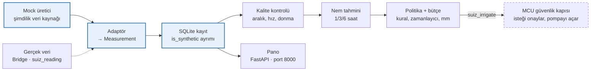
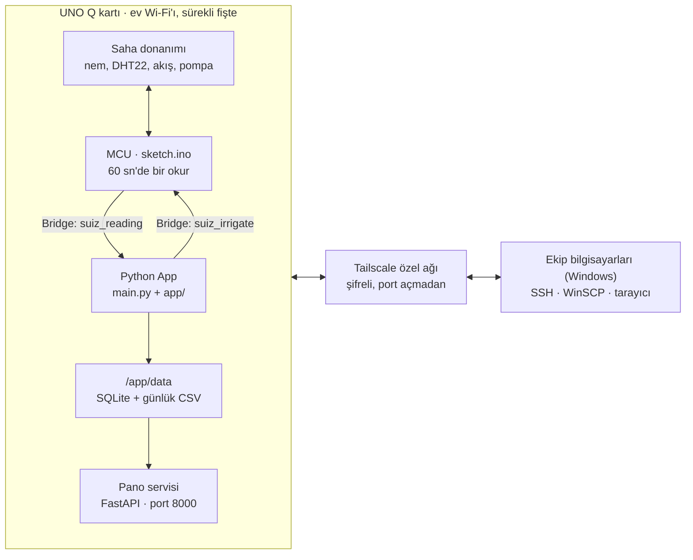

# Suİz — Yazılım Planı ve Durum Raporu

Nov 23, 2026 · @Aysima · **TASLAK — ekip onayı bekliyor**

## 1. Amaç ve kapsam

Yazılım ekibi, UNO Q'nun **Linux tarafında Python ile çalışan** bölümü yazar: veriyi almak, kaydetmek, kontrol etmek, sulama kararını üretmek ve panoda göstermek. Sensörleri okuyan ve pompayı süren MCU kodu donanım tarafındadır; iki taraf §4'teki veri sözleşmesiyle konuşur.

**Tek ekim yapılır.** İkinci bir tur olmadığı için yanlış kurulmuş bir sistemi düzeltme şansı yoktur. Bu yüzden aynı ekimin ilk dönemi **deneme verisi** için kullanılır (kalibrasyon, kuruma eğrileri, kural tabanlı sulama, modelin gölge modda denenmesi). Sistem doğrulanıp kod dondurulduktan sonra aynı bitkiler üzerinde **tam veri** (Yatak A zamanlayıcı, Yatak B Suİz) toplanır ve yayımlanır.

## 2. Genel mimari ve veri akışı



Bir ölçüm soldan sağa ilerler: kaydedilir, kontrol edilir, tahmine girer, karara dönüşür. **Şu an veri kaynağı mock üreticidir.** Gerçek veri geldiğinde yalnızca kaynak değişir; adaptörden sonraki her adım aynı kalır.

| Adım | Ne yapar | Örnek |
| --- | --- | --- |
| 1. Veri kaynağı | Şimdi: mock üretici sahte ölçüm üretir. Sonra: MCU 60 saniyede bir Bridge ile `suiz_reading` gönderir (§3–4). | Yatak B, 5 cm sensör: ADC 2150 |
| 2. Adaptör | Gelen kaydı ortak `Measurement` biçimine çevirir; ham ADC'yi kalibrasyonla % neme dönüştürür. Mock ve gerçek veri için iki ayrı adaptör vardır, çıktıları aynıdır. | `soil_5cm_pct = 28.4` |
| 3. SQLite kayıt | Her ölçümü kartın içindeki veritabanına yazar; mock kayıtlar `is_synthetic=true` ile işaretlidir ve raporlara girmez. | 2 yatak × 1440 kayıt/gün |
| 4. Kalite kontrolü | Ölçümün fiziksel olarak mümkün olup olmadığına bakar: aralık dışı, ani sıçrama, donma, iki derinliğin tutarsızlığı. Her sensöre 0–1 arası sağlık skoru verir; şüpheli veri karara girmez. | %21 → %91 → %24 = sıçrama |
| 5. Nem tahmini | Sulama yapılmazsa toprağın 1, 3 ve 6 saat sonra ne kadar kuruyacağını tahmin eder. | 3 saat sonra %25 |
| 6. Politika + bütçe | Tahmini, roka için sulama eşiğini ve kalan su bütçesini (mm) birlikte değerlendirir; gerekiyorsa doz hesaplayıp sulama isteği oluşturur. Yatak A için yalnızca zamanlayıcı çalışır. | Yatak B'ye 4 mm (0,96 L) |
| 7. MCU güvenlik kapısı | Donanım tarafındadır. Python pompayı doğrudan açamaz; yalnızca istek gönderir. MCU isteği depo seviyesi, azami süre, iki sulama arası bekleme ve günlük tavan kurallarına göre onaylar ya da reddeder, pompayı açar ve sonucu geri bildirir. Python çökse de pompa güvenli kalır. | Depo boş → `TANK_LOW`, ret |
| 8. Pano | SQLite'tan okur; son ölçümleri, kararları ve gerekçelerini, bütçeyi gösterir. FastAPI ile yazılır, port 8000'den açılır. | `http://suiz-unoq:8000` |

**Pano neden App Lab'de değil?** App Lab, Arduino'nun sketch'i ve Python kodunu karta yükleyip birlikte çalıştıran aracıdır. Bridge'i kullanan Python kodu (adım 1–7) bir App Lab uygulaması olarak çalışmak zorundadır; bu değişmez. Pano ise yalnızca SQLite dosyasını okuduğu için Bridge'e ihtiyaç duymaz. Bu yüzden FastAPI ile ayrı bir servis olarak yazılır: Windows'ta mock veriyle geliştirilir, kartta kendi başına çalışır ve App yeniden başlasa bile açık kalır.

## 3. Gerçek veri bağlantısı: karttan ekibe

**Karar:** Veri MCU'dan **Bridge** ile kartın Linux tarafındaki Python uygulamamıza gelir ve kartın içinde SQLite'a yazılır. Ekip, kartın bulunduğu yere gitmeden **Tailscale** özel ağı üzerinden karta bağlanır; veriyi oradan çeker ve panoyu açar. Ayrı bir "dosya gönderme" yolu kurulmaz.



Ölçüm, karar ve kayıt kartın içinde kalır; ekip yalnızca okumak ve kodu güncellemek için Tailscale üzerinden bağlanır.

### 3.1 Nerede ne çalışır

- **Kart:** donanımın kurulduğu evde, ev Wi-Fi'ına bağlı ve sürekli fişte. İnternet kesilse de ölçüm, karar ve kayıt devam eder; yalnızca uzaktan erişim ve hava durumu verisi durur.
- **Suİz App'i (App Lab uygulaması):** adı `suiz`, kartta `/home/arduino/ArduinoApps/suiz/` klasöründe durur. İçinde `sketch/` (MCU kodu), `python/` (Bridge'den veriyi alan, kaydeden ve karar veren kodumuz) ve `app.yaml` vardır. "Run at startup" açıktır; elektrik gidip gelince kendiliğinden başlar.
- **Veri dosyaları:** App'in Python kodu kartta bir konteyner içinde çalışır ve yalnızca `/app` altına yazılanlar kalıcıdır ([Arduino forum](https://forum.arduino.cc/t/does-arduino-uno-q-provide-an-api-for-reading-and-writing-flash/1459430)). Bu yüzden veritabanı `/app/data/suiz.sqlite`, günlük CSV'ler `/app/data/export/` altındadır. Kartın dosya sisteminde karşılığı `~/ArduinoApps/suiz/data/`.
- **Pano servisi:** FastAPI, kartta App'ten ayrı bir servis olarak çalışır, aynı SQLite dosyasını yalnızca okur ve **port 8000**'den yayın yapar. Kart açıldığında kendiliğinden başlar.

### 3.2 Uzaktan erişim neden Tailscale?

Ekip farklı şehirlerde olduğu için "aynı Wi-Fi" koşulu sağlanamaz. Tailscale, kartı ve ekibin bilgisayarlarını internet üzerinden şifreli bir özel ağda buluşturur; modemde port açmaya gerek kalmaz, kart internete açılmaz. Kişisel plan ücretsizdir ve 6 kullanıcıya kadar sınırsız cihazı kapsar ([Tailscale fiyatlandırma](https://tailscale.com/pricing)). Ekibimiz için yeterli. Windows'ta da çalışır.

App Lab'in Network Mode'u kartı yerel ağda otomatik bulur (mDNS); farklı evlerden bu keşif çalışmayabilir. Uzaktan işler bu yüzden **SSH** ile yapılır; VS Code'un Remote - SSH eklentisiyle kartın dosyaları doğrudan düzenlenebilir.

### 3.3 Bir kerelik kurulum

1. **Kart hazırlığı (donanım tarafı):** kart App Lab ilk kurulumuyla ev Wi-Fi'ına bağlanır, varsayılan `arduino` şifresi değiştirilir, kartın adı `suiz-unoq` yapılır.
2. **Tailscale hesabı:** ekip için tek bir Tailscale hesabı açılır ve tüm ekip üyeleri davet edilir.
3. **Kartı ağa eklemek:** kartta SSH ile Tailscale kurulur ve ekip ağına bağlanır. Kartın bağlantısı kendiliğinden düşmesin diye yönetim panelinde kart için "Disable key expiry" seçilir.
4. **Bilgisayarları ağa eklemek:** her ekip üyesi kendi bilgisayarına (Windows) Tailscale'i kurar ve davetli hesapla girer.
5. **Bağlantı testi:** herkes kendi bilgisayarından `ssh arduino@suiz-unoq` ile kartın terminaline girebilmeli.
6. **Uygulamayı kurmak:** `suiz` App'i oluşturulur, Bridge PoC (§4.6) çalıştırılır, "Run at startup" açılır; pano servisi kurulur.

### 3.4 Günlük kullanım: veriye nasıl ulaşırız?

Tüm ekip üyeleri verinin tamamına aynı yollardan erişir.

| İhtiyaç | Yol |
| --- | --- |
| Son durumu görmek | Tarayıcıdan pano: `http://suiz-unoq:8000` |
| Ham veriyi analiz için almak | WinSCP veya `scp` ile `~/ArduinoApps/suiz/data/export/` altındaki günlük CSV'leri indirmek |
| Tüm veritabanını almak | Aynı yoldan `~/ArduinoApps/suiz/data/suiz.sqlite` dosyasını indirmek |
| Canlı log izlemek | `ssh arduino@suiz-unoq` ile girip App loglarına bakmak |
| Python kodunu güncellemek | Main'e merge → kartta `git pull` → `scripts/deploy.sh` kodu App klasörüne kopyalar ve App'i yeniden başlatır |
| Sketch'i güncellemek | App Lab ile, kartın bulunduğu yerel ağdan |

### 3.5 Yedekleme ve güvenlik

- Python uygulaması her gece bir önceki günün ölçümlerini `data/export/YYYY-MM-DD.csv` olarak yazar. Ham veri git'e konmaz; yazılım ekibi haftalık olarak ortak bir klasöre (ör. Google Drive) kopyalar. Bu adım ileride otomatikleştirilebilir.
- Kart internete doğrudan açılmaz (port yönlendirme yok); erişim yalnızca Tailscale'deki ekip üyelerine açıktır.
- **Yedek plan:** Tailscale kurulamazsa donanımcı günlük CSV'leri ortak klasöre elle yükler; pano yalnızca onun evinden görülür.

## 4. Veri sözleşmesi v1: mesaj adları ve alanlar

Bu bölüm donanımcı ile yazılım ekibinin ortak referansıdır. **Sketch ve Python aynı adları, aynı sırayla kullanır.** Sözleşmenin tek kaynağı bu bölümdür; Python'daki karşılığı `app/ingest/contract.py`'dir. Donanım tarafı onaylayana kadar düzeltmeler `v=1` içinde yapılır; onaydan sonra bir alanın ya da anlamın her değişikliği `v` numarasını artırır.

**24 Kasım 2026 düzeltmeleri** (komutlar yazılmadan önce eksik kalan kurallar; donanım onayı bekliyor): `suiz_irrigate` hacmi mL yerine akış darbesi olarak gönderir (§4.1 madde 4 ile çelişiyordu), `req_id` ve süre sınırı kuralları yazıldı, kilit ve `suiz_reset_lock` tanımlandı, DHT okunamazsa iki değer de `-1` olur (§4.3–4.5). Donanım tarafının kararını bekleyen maddeler ⏳ ile işaretli ve §4.7'de toplandı.

**26 Kasım 2026, donanım incelemesi (PR #10):** §4.7'deki kararlar yazıldı (tek pompa, günlük tavan, yedek modda sulama yok); ADC çözünürlüğü, aralık dışı eşikleri, şamandıra filtresi, pompa çalışırken DHT ve nem kuralları ve açılış durumu eklendi (§4.1, §4.2, §4.3, §4.6). Doz süresi düzeltildi. Yedek kural kararı proje sitesine ve README §5, §8'e de işlendi.

### 4.1 Genel kurallar

1. Tüm Bridge fonksiyon adları `suiz_` ile başlar.
2. Argümanlar tablodaki **sırayla** gönderilir. İlk argüman her zaman `v` (sözleşme sürümü, şimdilik `1`).
3. Bir Bridge mesajı en fazla 256 bayt olabilir; bu yüzden her yatak ayrı mesajla gönderilir ([mischianti.org](https://mischianti.org/arduino-uno-q-bridge-how-python-and-the-stm32-sketch-talk-call-notify-provide/)).
4. **MCU ham değer gönderir** (ADC sayısı, akış darbesi). Yüzde nem ve litre Python'da kalibrasyon dosyasıyla hesaplanır; kalibrasyon değişince sketch yeniden yüklenmez.
5. **Zaman damgasını Python atar** (UTC). MCU yalnızca `up_ms` (açılıştan beri milisaniye) gönderir; sıra ve kayıp mesaj tespiti `seq` ve `up_ms` ile yapılır.
6. Okunamayan sayısal değer `-1` olarak gönderilir ve ilgili durum alanı `1` olur. Python bunu `None` olarak kaydeder.
7. Örnekleme süresi sketch'te tek bir sabittir: `SAMPLE_PERIOD_S = 60`. Sulamadan sonraki 15 dakika `30` saniyeye iner. Değiştirmek sözleşme değişikliği sayılmaz.
8. **Açılış:** sketch `setup()`'ın ilk satırlarında pompa pinlerini (D10, D11) `OUTPUT` ve `LOW` yapar; pompalar kapalı başlar.
9. **Döngü beklemez:** sketch'in ana döngüsünde uzun bekleten kod (`delay()` gibi) bulunmaz; süreler `millis()` ile ölçülür. Akış darbeleri kesmeyle sayılamazsa yedek yöntem döngüde yaklaşık 1 ms'de bir yoklamadır (§4.7 madde 4) ve bu yalnızca döngü beklemezse çalışır.

**Ölçüm sıklıkları doğru mu?** Evet. Toprak nemi saatler içinde değiştiği için 60 saniye gereğinden sıktır ama zararı yoktur: sulamanın toprağa inişini dakika dakika gösterir ve veri hacmi küçüktür (2 yatak × 1440 = 2880 satır/gün). **15 saniye bir ölçüm değildir;** Python'un MCU'ya gönderdiği "çalışıyorum" sinyalidir (heartbeat).

| Ne | Sıklık | Neden uygun |
| --- | --- | --- |
| Toprak nemi, 5 ve 10 cm | 60 sn, 9 okumanın medyanı | 15 cm'lik kasada kuruma günde birkaç puandır. Medyan tekil sıçramaları süzer. Model ve karar 10 dakikalık ortalamalarla çalışır. |
| Sulamadan sonraki 15 dk | 30 sn | Suyun önce 5 cm'ye, sonra 10 cm'ye inişi dakikalar içindedir. Bu sıklık "su gerçekten kök bölgesine ulaştı mı?" sorusunu cevaplar. |
| Hava sıcaklığı ve nemi | 60 sn | Bitki su tüketimi (ET) saatlik ölçekte hesaplanır; dakikalık veri fazlasıyla yeterlidir. |
| Akış sensörü | Darbeler MCU'da kesmeyle sürekli sayılır; toplam 60 sn'de bir ve her sulamanın sonunda gönderilir | Darbe kaçırılırsa hacim eksik çıkar; bu yüzden sayma işi MCU'dadır, Python yalnızca toplamı okur. |
| Şamandıra | MCU'da sürekli izlenir; 60 sn'de bir raporlanır | Depo boşalınca kilit Python'u beklemeden anında devreye girer. |
| Heartbeat (ölçüm değil) | 15 sn; 60 sn gelmezse güvenli mod | Python'un çalıştığını gösterir. Art arda 3 kaçırmayı tolere eder, 4.'de pompa kapanır. |
| Sulama kararı | 10 dk | Bitkinin su ihtiyacı saatlik ölçekte değişir; daha sık karar aynı sonucu tekrarlar. |

**Tarla gözüyle dikkat edilecekler:**

- **Doz küçüktür:** 0,24 m²'lik yatakta 1 mm su 240 mL'dir. İnce hortum ve akış sensörü üzerinden debi tahminen dakikada 0,5–1 L olduğundan zamanlayıcının her dozu (≈ 1 mm) yaklaşık 15–30 saniyelik çalışmaya denk gelir; kesin süre debi ölçülünce belli olur. Akış sensörünün bu küçük hacmi doğru sayması deneme döneminde mezürle kontrol edilmelidir.
- **Kapasitif sensörler sıcaklıktan etkilenir:** balkonda gece-gündüz farkı okumada günlük dalgalanma yaratabilir. Kuruma eğrileri sıcaklıkla birlikte kaydedilir; dalgalanma büyükse sıcaklık düzeltmesi eklenir.
- **Roka eşikleri başlangıçta tahmindir:** sulama eşiği ve hedef nem `crops/roka.yaml`'da tutulur ve deneme verisiyle (kalibrasyon ve kuruma eğrileri) ayarlanır. Tek ekim olduğu için bu ayar tam veri dönemi başlamadan bitmiş olmalıdır.

### 4.2 MCU → Python: `suiz_reading`

`Bridge.notify`, her yatak için ayrı, her örnekleme periyodunda. Python `Bridge.provide("suiz_reading", ...)` ile karşılar.

| # | Alan | Tip | Anlam |
| --- | --- | --- | --- |
| 1 | `v` | int | Sözleşme sürümü: 1 |
| 2 | `bed` | str | `"A"` veya `"B"` |
| 3 | `seq` | int | Yatak başına artan sayı (açılışta 0) |
| 4 | `up_ms` | int | MCU açılışından beri ms |
| 5 | `soil5_adc` | int | 5 cm sensör, 9 okumanın medyanı, 12 bit (0–4095; sketch `analogReadResolution(12)` çağırır); `soil5_st = 1` ise `-1` |
| 6 | `soil10_adc` | int | 10 cm sensör, aynı kural |
| 7 | `soil5_st` | int | 0 normal, 1 aralık dışı (kopuk ya da kısa devre): medyan ADC < 50 ya da > 4000. Eşikler sketch'te sabittir |
| 8 | `soil10_st` | int | 10 cm için aynı kod |
| 9 | `flow_pulses` | int | Açılıştan beri toplam akış darbesi; sıfırlanmaz |
| 10 | `tank_ok` | int | Şamandıra: 1 su var, 0 su yok. Yalnızca 2 saniye boyunca aynı kalırsa değişir (pompa suyu çalkalarken gereksiz `TANK_LOW` olmasın diye). Kontak su varken kapalıdır; tel koparsa "su yok" okunur |
| 11 | `pump_on` | int | 1 pompa şu an çalışıyor, 0 kapalı |

**Aralık dışı ve kopuk sensör:** MCU aralık dışını yakaladığında ADC yerine `-1` gönderir (§4.1 madde 6; `contract.py` `-1` ile `st = 1`'in birlikte gelmesini bekler). Kopan bir sensör kablosunda analog giriş boşta kalıp aralık içinde rastgele değerler okuyabilir; bunu MCU her zaman yakalayamaz, Python kalite katmanı (`spike`, `freeze`) yakalar.

### 4.3 MCU → Python: `suiz_ambient`, `suiz_irrigation_result`, `suiz_safety`

| Mesaj | Ne zaman | Alanlar (sırayla) |
| --- | --- | --- |
| `suiz_ambient` | Her periyotta bir kez (DHT22 iki yatağa ortak) | `v`, `seq`, `up_ms`, `air_temp_c` (float), `air_rh_pct` (float), `dht_st` (0 normal, 1 okunamadı). `dht_st = 1` ise `air_temp_c` ve `air_rh_pct` **ikisi de** `-1` gönderilir; böylece gerçek −1 °C ile "okunamadı" karışmaz. Pompa çalışırken DHT22 okunmaz (kütüphane okuma sırasında kesmeleri birkaç ms kapatır, akış darbesi kaçabilir); o periyodun okuması pompa durunca yapılıp gönderilir |
| `suiz_irrigation_result` | Her sulama isteği bittiğinde ya da reddedildiğinde | `v`, `req_id` (int), `bed`, `result` (`"done"`, `"rejected"`, `"aborted"`), `reason` (kod, §4.5), `run_ms` (int), `pulses` (bu sulamadaki darbe) |
| `suiz_safety` | Güvenlik olayı anında | `v`, `bed` (`"A"`, `"B"` ya da genel olaylar için `"-"`), `code` (§4.5), `up_ms` |

### 4.4 Python → MCU

| Fonksiyon | Tür | Alanlar (sırayla) | Dönüş |
| --- | --- | --- | --- |
| `suiz_irrigate` | `Bridge.call`; sketch `provide_safe` ile karşılar | `v`, `req_id` (int), `bed`, `target_pulses` (int), `max_run_s` (int) | Hemen `"OK"` ya da ret kodu (§4.5); MCU sulamanın bitmesini beklemeden cevap verir. Sonuç ayrıca `suiz_irrigation_result` ile gelir |
| `suiz_heartbeat` | `Bridge.notify`, 15 saniyede bir | `v`, `seq` | Yok. MCU 60 saniye heartbeat almazsa pompayı kapatır, güvenli beklemeye geçer ve `HEARTBEAT_LOST` gönderir. Güvenli beklemede pompa hiç çalışmaz; ilk heartbeat'te normal moda dönülür (§4.7 madde 3) |
| `suiz_reset_lock` | `Bridge.call` | `v`, `bed` | `"OK"` (kilit açıldı ya da zaten açıktı) ya da `BAD_ARGS`. Yalnızca kullanıcı isteğiyle çağrılır; Python kendiliğinden çağırmaz |

**`suiz_irrigate` kuralları**

1. **Hacim darbe olarak gönderilir.** Python, istenen hacmi kalibrasyon dosyasındaki "litre başına darbe" değeriyle `target_pulses`'a çevirir. MCU hesap yapmaz: pompayı açar, bu sulamada saydığı darbe `target_pulses`'a ulaşınca kapatır. Böylece kalibrasyon yalnızca Python'da kalır (§4.1 madde 4) ve istek ile sonuç (`pulses`) aynı birimdedir.
2. **Süre sınırı:** MCU, `max_run_s` ile kendi sabit sınırından (60 sn, README §8) **hangisi küçükse** onu uygular. Süre dolduğunda hedefe ulaşılmamışsa sulama `aborted` / `MAX_RUNTIME` ile biter.
3. **`req_id`:** Python üretir; 1'den başlar, her istekte artar, Python yeniden başlasa da tekrar etmez (Python'da kalıcı kayıttan gelir). 32 bit işaretli tam sayıya sığar. MCU bu sayıyı yorumlamaz, yalnızca `suiz_irrigation_result` içinde aynen geri gönderir.
4. **Tekrar deneme yok:** `Bridge.call` hata verir ya da zaman aşımına uğrarsa Python aynı isteği kendiliğinden tekrar göndermez (MCU ilk isteği almış olabilir; tekrar, çift sulama demektir). Bir sonraki karar döneminde politika durumu yeniden değerlendirir. **İstisna:** `BUSY` ile reddedilen istek MCU'ya ulaşmış ama uygulanmamıştır; Python onu bir sonraki karar döneminde yeni bir `req_id` ile yeniden ister. Böylece örneğin Yatak B sulanırken Yatak A'nın zamanlayıcı dozu kaybolmaz.
5. **`BAD_ARGS`:** `v ≠ 1`, `bed` `"A"` ya da `"B"` değil, `target_pulses ≤ 0` ya da `max_run_s ≤ 0` ise istek reddedilir.
6. **`MIN_INTERVAL`:** 20 dakika, o yatakta pompanın en son **durduğu** andan sayılır. Reddedilen istekler sayılmaz. MCU açıldıktan sonraki ilk istek bu kurala takılmaz.
7. **Yarıda kesilen sulama:** Pompa çalışırken depo boşalırsa sulama `aborted` / `TANK_LOW`, heartbeat kaybolursa `aborted` / `HEARTBEAT_LOST` ile biter. Kabul edilen (`"OK"` dönülen) her istek için tam olarak bir `suiz_irrigation_result` gönderilir.
8. **Zaman sayımı:** MCU süreleri `millis()` ile ölçer. `millis()` işaretsiz 32 bittir ve yaklaşık 49,7 günde başa döner; karşılaştırmalar `millis() - baslangic >= sure` biçiminde yazılırsa başa dönüşte de doğru çalışır.

**Kilit kuralları**

1. Bir yatakta art arda **2** sulama `NO_FLOW` ile biterse o yatak kilitlenir (README §8) ve MCU `suiz_safety` ile `LOCKED` gönderir. Akış görülen (en az bir darbe sayılan) her sulama bu sayacı sıfırlar. Kilit elektrik kesintisinden sonra korunmaz; MCU açılışta kilitsiz başlar ve `BOOT` gönderir. Arıza sürüyorsa ilk 2 sulamada (her biri en çok 3 sn kuru çalışma) kilit yeniden devreye girer.
2. Kilitli yatağa gelen her `suiz_irrigate` `LOCKED` ile reddedilir.
3. Kilit yalnızca `suiz_reset_lock` ile açılır. Kullanıcı arızayı (hortum, pompa) giderdikten sonra çağırır; MCU arızanın giderildiğini doğrulayamaz, bu yüzden isteği her zaman uygular. Arıza sürüyorsa sonraki 2 sulamada kilit yeniden devreye girer.
4. Depo boşken (`tank_ok = 0`) pompa çalıştırılmaz (README §8'deki şamandıra kilidi) ama yatak `LOCKED` durumuna geçmez: istekler `TANK_LOW` ile reddedilir, kova doldurulunca `suiz_reset_lock` gerekmeden yeniden kabul edilir.

**Yatak A'nın zamanlayıcısı Python'dadır:** `policy/timer.py` günde iki kez `suiz_irrigate` gönderir. Böylece iki yatağın sulaması aynı yoldan geçer, aynı güvenlik kurallarına tabi olur ve aynı biçimde kaydedilir. MCU yalnızca istekleri uygular ve denetler.

### 4.5 Kodlar

| Kod | Nerede | Anlam |
| --- | --- | --- |
| `OK` | dönüş | İstek kabul edildi |
| `TANK_LOW` | ret, aborted, safety | Şamandıra su yok diyor |
| `BUSY` | ret | Pompalardan biri çalışıyor; aynı anda yalnızca bir pompa çalışır (§4.7 madde 1) |
| `MIN_INTERVAL` | ret | O yatakta pompa durduğundan bu yana 20 dakika geçmedi |
| `DAILY_LIMIT` | ret | Bu istekle yatağın son 24 saatteki darbe toplamı tavanı aşar (geçici tavan 9000 darbe, §4.7 madde 2) |
| `LOCKED` | ret, safety | Ret: yatak kilitli, `suiz_reset_lock` gerekir. Safety: yatak şimdi kilitlendi (art arda 2 `NO_FLOW`) |
| `BAD_ARGS` | ret | Argüman eksik ya da hatalı |
| `NO_FLOW` | aborted, safety | Pompa açıldı ama 3 saniyede akış darbesi yok |
| `MAX_RUNTIME` | aborted, safety | Hedef darbeye ulaşılmadan süre sınırı doldu (`max_run_s` ya da 60 sn, hangisi küçükse) |
| `HEARTBEAT_LOST` | aborted, safety | Python'dan 60 saniyedir haber yok |
| `BOOT` | safety | MCU yeniden başladı (`seq` sıfırlanır) |

Süre ve hacim sınırları README §8'deki değerlerdir; MCU'da sabit olarak tutulur.

### 4.6 Python tarafında karşılıklar ve Bridge PoC

**Pompa çalışırken nem:** pompa açılışında ortak GND hattında gerilim oynar. Python, `pump_on = 1` olan `suiz_reading` satırlarını kaydeder ama bu satırlardaki nem değerlerini karara almaz.

`bridge_adapter.py` gelen mesajları ortak `Measurement` modeline çevirir: `soil5_adc` → `soil_5cm_adc`, `soil10_adc` → `soil_10cm_adc`, kalibrasyondan sonra `soil_5cm_pct` ve `soil_10cm_pct`; `flow_pulses` → `flow_pulses_total`; `air_temp_c` → `air_temperature_c`; `air_rh_pct` → `relative_humidity_pct`. Ortam ölçümü `bed_id="ENV"` olarak saklanır. Mock üretici de aynı alanları üretecek şekilde güncellenir; böylece mock ve gerçek veri aynı yoldan geçer.

Arıza etiketleri: MCU yalnızca donanım düzeyindeki aralık dışı durumunu (`*_st = 1`) bildirir. `spike` ve `freeze` gibi etiketleri Python kalite katmanı üretir; ad `freeze` olarak kalır.

**Bridge PoC: ilk ortak deneme.** PoC (proof of concept), "iki taraf gerçekten konuşabiliyor mu?" sorusunu gerçek sensör beklemeden cevaplayan küçük bir denemedir. Başarılı olursa sözleşmedeki adların ve alan sıralarının iki tarafta da aynı olduğu kanıtlanır.

1. App Lab'de `suiz` adıyla yeni bir App açılır.
2. Sketch, 60 saniyede bir **sabit sayılarla** bir `suiz_reading` gönderir (ör. yatak `"A"`, ADC `2000` ve `2100`).
3. Python bu mesajı karşılar ve 11 alanı ekrana yazar. Beklenen: sayılar sketch'tekilerle aynı, sıra doğru.
4. Python 15 saniyede bir `suiz_heartbeat` gönderir; sketch aldığında karttaki LED'i yakar. Beklenen: LED düzenli yanıp söner.
5. Python kapatılır. Beklenen: 60 saniye sonra sketch `HEARTBEAT_LOST` gönderir (Python kapalı olduğu için loglarda görülür).
6. Python bir `suiz_irrigate` çağrısı yapar; sketch pompayı açmadan yalnızca `"OK"` döner. Beklenen: Python `"OK"` alır.

Altındaki iki parça, aynı mesajın iki taraftaki karşılığıdır:

```cpp
// sketch (donanımcı)
Bridge.notify("suiz_reading", 1, "A", seq, millis(), s5, s10, 0, 0, pulsesA, tankA, pumpA);
Bridge.provide_safe("suiz_irrigate", on_irrigate);
```

```python
# python/main.py (yazılım)
def on_reading(v, bed, seq, up_ms, soil5_adc, soil10_adc,
               soil5_st, soil10_st, flow_pulses, tank_ok, pump_on):
    ...
Bridge.provide("suiz_reading", on_reading)
answer = Bridge.call("suiz_irrigate", 1, req_id, "B", target_pulses, 60)
```

### 4.7 Donanım tarafının kararını bekleyenler

⏳ işaretli maddeler sketch'i yazan donanım tarafının kararını bekler. Her maddede yazılım tarafının önerisi vardır; uygunsa öneri kabul edilir, değilse karar buraya yazılır. Karar verilince madde "Karar:" satırıyla kapatılır ve §4.4–4.5'teki ⏳ işareti kaldırılır. Sözleşme donanım tarafınca onaylanana kadar sürüm `v=1` kalır.

1. **İki pompa aynı anda çalışabilir mi? (`BUSY`)** İki pompa ve akış sensörleri aynı 5 V 2 A adaptörden beslenir; aynı anda çalışmaları gerilim düşüşüne ve nem okumalarında bozulmaya yol açabilir.
   **Karar (26 Kasım 2026, donanım):** aynı anda yalnızca bir pompa çalışır; bir pompa çalışırken iki yataktan gelen her istek `BUSY` ile reddedilir. `BUSY` reddi "tekrar deneme yok" kuralının istisnasıdır (§4.4 madde 4).
2. **`DAILY_LIMIT`: "gün" nedir, tavan kaç darbedir?** MCU'da takvim saati yoktur (zamanı Python atar, §4.1 madde 5), bu yüzden "gece yarısı" bilinemez.
   **Karar (26 Kasım 2026, donanım):** son 24 saatlik kayan pencere (`millis()` ile), yatak başına sabit tavan. Geçici tavan **9000 darbe**: YF-S401'in tipik ~5880 darbe/L değeriyle ≈ 1,5 L, normal günlük ihtiyacın yaklaşık 3 katı. Litre başına darbe kalibrasyonla ölçülünce güncellenir. MCU yeniden başlarsa pencere sıfırlanır; kabul edildi.
3. **Yedek kural modu (heartbeat kaybı).** README §8 eskiden "MCU sınırlı hacimli yedek kural moduna geçer" diyordu ama modun ayrıntısı tanımlı değildi.
   **Karar (26 Kasım 2026, donanım):** heartbeat kaybında güvenli bekleme: pompa hiç çalışmaz, ilk heartbeat'te normal moda dönülür. Gerekçe: Python birkaç dakikada yeniden başlar; olası bir yedek sulama ise kaydı ve bütçeyi karıştırır. Proje sitesi ve README §5, §8 bu karara göre güncellendi.
4. ⏳ **Akış darbelerinin kesmeyle sayılması.** Kesme pinlerinin UNO Q çekirdeğinde çalıştığı henüz doğrulanmadı (proje sitesi, "Henüz doğrulanmadı").
   **Karar (26 Kasım 2026, donanım): test sonrası.** `attachInterrupt` D2/D3'te ilk güç verme haftasında (en geç 7 Aralık) denenir. Çalışmazsa yedek yöntem: ana döngüde yaklaşık 1 ms'de bir pini yoklayıp kenar saymak (§4.1 madde 9). `target_pulses` iki durumda da aynı kalır. Test sonucu buraya yazılınca ⏳ kaldırılır.
5. ⏳ **60 sn sınırı ve debi.** Tahmini debi dakikada 0,5–1 L ise 60 saniyelik sınır tek sulamayı yaklaşık 0,5–1 L ile (≈ 2–4 mm) kısıtlar; README §4.3 ise tek sulamayı 1,2 L'ye (5 mm) kadar ve debiyi 1–2 L/dk olarak varsayar. *Öneri:* debi ilk testte ölçülene kadar sınır 60 sn kalır; Python bir isteğin `target_pulses`'ını ölçülen debiyle 60 saniyeye sığacak şekilde sınırlar, daha büyük dozu sonraki karar dönemlerine böler. Debi ölçülünce sınırın korunup korunmayacağına ve README §4.3'ün güncellenmesine birlikte karar verilir.

## 5. Şu ana kadar yapılanlar (Hilal, 21 Kasım)

Hilal veri hattının **ilk iki halkasını** kurdu: sahte sensör verisi üretmek ve bunu SQLite'a kaydetmek. PR #4 ile 23 Kasım'da main'e alındı; 42 test geçiyor. Karar, model, pano ve gerçek veri alma henüz yok.

| Dosya | Ne yapıyor | Durum |
| --- | --- | --- |
| `simulation/mock_sensors.py` | A ve B yatakları için dakikada bir sahte kayıt üretir: 5 ve 10 cm nem (ham ADC + %), ortak sıcaklık ve hava nemi. Toprak yavaşça kurur; sulama olayı üst sensörü hemen, altı bir örnek sonra yükseltir. `spike`, `freeze`, `disconnect` arızaları enjekte edilebilir. Aynı seed aynı veriyi verir. | main'de |
| `app/storage/measurement.py` | Uygulamanın ortak ölçüm modeli `Measurement`: yatak, zaman (UTC), kaynak, `is_synthetic`, sensör kanalları (`soil_5cm_adc` gibi). Hatalı değerleri reddeder. | main'de |
| `app/storage/sqlite.py` | Ölçümleri yerel SQLite dosyasına yazar ve okur. Aynı kaydın tekrar gönderilmesini sessizce yutar, farklı değerle çakışırsa hata verir. | main'de |
| `app/ingest/mock_adapter.py` | Mock kaydı `Measurement` modeline çevirir. Gerçek veri adaptörü aynı kalıpla yazılacak. | main'de |
| `tests/` (3 dosya) | Üretici, depolama ve uçtan uca mock → SQLite testleri. | main'de |

**Hangi aşamada:** README'deki 7 adımlık zincirde (Ölç → Doğrula → Tahmin → Karar → Uygula → Sonucu doğrula → Pano) yalnızca "Ölç" adımının kayıt kısmı, mock veriyle hazır. Temel sağlam; geri kalan her modül bu `Measurement` + SQLite üzerine kurulacak.

**23 Kasım ilerlemesi:** PR #4 main'e alındı. Bu rapor ile veri yolu (Bridge → kart içinde SQLite → Tailscale ile ekip erişimi), mesaj adları ve alanları (sözleşme v1), pano kararı (FastAPI, port 8000) ve GitHub klasör yapısı netleşti. Sıradaki adımlar: donanım tarafının sözleşmeyi onaylaması, ardından PR #5'in bu içerikle güncellenmesi ve `requirements.txt` ile test hattının kurulması.

## 6. Eksikler ve açık kararlar

Veri yolu artık belli (Bridge, §3) ve mesaj adları önerildi (§4). En kritik eksik, **donanımcının sketch'i bu sözleşmeye göre yazması ve Bridge PoC'nin çalışması**. Bu olmadan gerçek veri sisteme giremez ve E2 kuruma verisi kaybolabilir.

**Mevcut koddaki eksikler**

- Sensör `status` bilgisi SQLite'a kaydedilmiyor.
- Arıza adı tutarsız: mock `freeze`, sözleşme `stuck`.
- CSV dışa aktarımı yok (analiz ve yayın için gerekli).
- `requirements.txt` ve otomatik test (CI) yok.
- Mock, README §7.3'teki fizik tabanlı simülatör değil (ET, mm cinsinden doz yok); model ön eğitimi için ayrı simülatör gerekecek.

**Hiç başlanmamış modüller**

- Gerçek veri adaptörü, kalibrasyon (ham ADC → % nem), akış ve depo hacmi hesabı
- Sensör sağlığı ve anomali kontrolü
- Kural tabanlı ve zamanlayıcı politikası, su bütçesi (mm), karar kaydı
- Open-Meteo istemcisi (ET₀, radyasyon)
- Nem tahmin modeli ve gölge mod
- Yerel web panosu
- Ürün uygunluk ve senaryo motoru

**Ekip kararı bekleyen noktalar**

- [x] Veri yolu: Bridge; Python kodu kartta çalışır, ekip Tailscale ile bağlanır (§3)
- [x] Arıza adı: `freeze` (§4.6)
- [x] `status` kaynağı: MCU yalnızca aralık dışını bildirir, diğer etiketleri Python üretir (§4.6)
- [x] Zaman damgası: Python atar, UTC (§4.1)
- [x] Sulama isteği, sonucu ve güvenlik olaylarının alanları (§4.3–4.5)
- [x] Yatak A zamanlayıcısı Python'da (§4.4)
- [x] Pano: FastAPI, kartta ayrı servis, port 8000 (§2, §3.1)
- [x] Tek ekim: deneme verisi, dondurma, tam veri (§1, §8)
- [ ] Donanım tarafının sözleşme v1'i onaylaması (§10)
- [ ] `status` alanının SQLite'ta nerede tutulacağı (sütun mu, ayrı tablo mu)
- [x] README, site ve donanım planındaki iki turlu takvimin tek ekime göre güncellenmesi (23 Kasım)

## 7. Hedef klasör ve dosya yapısı

Yazılım main dalında, README §14'teki yapıya uygun klasörlerde durur; ayrı bir uzun ömürlü yazılım dalı açılmaz. ✅ = var, diğerleri oluşturulacak.

```text
su-z/
├── app/                        # bizim Python paketimiz (Windows'ta da çalışır)
│   ├── storage/
│   │   ├── measurement.py      ✅ ortak ölçüm modeli
│   │   ├── sqlite.py           ✅ ölçüm kaydı
│   │   ├── events.py           sulama sonucu ve güvenlik olayı kayıtları
│   │   └── export_csv.py       gece günlük CSV dışa aktarım
│   ├── ingest/
│   │   ├── mock_adapter.py     ✅ mock → Measurement (sözleşme v1'e uyarlanacak)
│   │   ├── contract.py         §4'teki mesaj adları, alan sıraları ve kodlar (tek kaynak)
│   │   ├── bridge_adapter.py   suiz_* mesajları → Measurement; kartı tanıyan TEK dosya
│   │   └── calibration.py      ham ADC → % nem, darbe → litre
│   ├── control/
│   │   ├── commands.py         suiz_irrigate, suiz_reset_lock çağrıları
│   │   └── heartbeat.py        15 sn'de bir suiz_heartbeat
│   ├── quality/checks.py       aralık, hız, donma, çapraz tutarlılık, sağlık skoru
│   ├── weather/open_meteo.py   ET₀ ve radyasyon; internet yoksa Hargreaves
│   ├── policy/
│   │   ├── timer.py            Yatak A: günde iki kez ≈ 1 mm
│   │   ├── rules.py            Yatak B MVP: eşik kuralı
│   │   ├── budget.py           su bütçesi (mm), 72 saat penceresi
│   │   └── decision_log.py     her kararın girdisi, gerekçesi, sonucu
│   ├── models/                 baz çizgisi ve 1/3/6 saat nem tahmini
│   ├── crops/roka.yaml         ürün profili: eşikler, Kc, Ky
│   ├── scenario/engine.py      FAO-33 senaryo motoru
│   ├── dashboard/              FastAPI pano (kartta ayrı servis, SQLite'ı okur, port 8000)
│   └── runtime.py              döngüyü kuran giriş noktası (kaynak: mock ya da bridge)
├── uno-q-app/                  # kartta ~/ArduinoApps/suiz/ olarak çalışan App Lab uygulaması
│   ├── app.yaml
│   ├── sketch/sketch.ino       donanımcının MCU kodu (§4'e göre)
│   └── python/main.py          ince giriş: app paketini yükler, runtime'ı bridge kaynağıyla başlatır
├── config/
│   ├── calibration.yaml        E1 sonuçları: kuru/doygun ADC, darbe/litre
│   └── settings.yaml           yatak alanları, bütçeler, eşikler
├── scripts/deploy.sh           kartta: git pull → uno-q-app'i ~/ArduinoApps/suiz'e kopyala → App'i yeniden başlat
├── simulation/
│   ├── mock_sensors.py         ✅ sahte sensör verisi
│   └── water_balance.py        fizik tabanlı simülatör (model ön eğitimi)
├── notebooks/                  E2 analizi, model eğitimi, E5 sonuçları
├── tests/                      ✅ her modülün testi; Bridge testleri sahte Bridge ile
├── requirements.txt
└── .github/workflows/tests.yml
```

**Kural:** `arduino.app_utils` (Bridge) yalnızca `bridge_adapter.py` ve `control/` içinde import edilir. Geri kalan her şey Windows'ta mock veriyle çalışır ve test edilir. Dosya adları öneridir; modül başlarken PR'da netleşir.

## 8. Fazlara göre plan ve takvim


Tek ekim olduğu için fazlar tarihten çok **sırayla** bağlıdır: bir faz bitmeden sonrakinin verisi güvenilir olmaz. Görevlerin ayrıntısı §11'de.

- **Faz 0 — Sözleşme, altyapı, PoC:** bu rapor ve sözleşme v1 onaylanır, test hattı ve Tailscale kurulur, Bridge PoC çalışır.
- **Faz 1 — Gerçek veri hattı:** gerçek ölçümler SQLite'a girmeye başlar; kalibrasyon ve CSV dışa aktarımı hazırdır. Bu andan itibaren kaydedilen her ölçüm deneme verisidir.
- **Faz 2 — Kural tabanlı sulama (MVP):** zamanlayıcı (Yatak A) ve eşik kuralı (Yatak B) gerçek pompayı sürer; komutlar, heartbeat, karar kaydı ve bütçe çalışır. Güvenlik testleri (E3) bu fazda yapılır.
- **Faz 3 — Model, kalite, pano:** kalite kontrolleri, nem tahmini (önce gölge modda: karar üretir ama pompayı sürmez), pano ve senaryo motoru. Roka eşikleri deneme verisiyle ayarlanır.
- **Kod dondurma:** sistemin deneme verisinde doğru çalıştığı görülünce kod etiketlenir; sonrasında yalnızca güvenlik düzeltmesi yapılır.
- **Faz 4 — Tam veri toplama (A/B):** aynı bitkiler üzerinde Yatak A zamanlayıcıyla, Yatak B Suİz ile sulanır. Yayımlanacak sonuçlar yalnızca bu dönemin verisinden çıkar.
- **Faz 5 — Analiz ve yayın:** hasat ölçümleri, su kullanımı karşılaştırması, grafikler, GitHub ve Project Hub yayını.

**Risk:** deneme dönemi uzarsa tam veri dönemi kısalır. Bu yüzden Faz 1–2 önceliklidir; Faz 3'ün model ve senaryo kısmı gerekirse kapsam kesme sırasına göre kısaltılır (§11 sonu). README, site ve donanım planındaki takvim 23 Kasım 2026'da bu plana göre güncellendi (ekim en geç 30 Kasım, dondurma 16 Aralık, tam veri 17 Aralık – 5 Ocak).

## 9. Çalışma kuralları ve bitti tanımı

Tek kaynak main dalıdır; her iş kısa ömürlü bir dalda yapılır ve birkaç gün içinde PR ile main'e girer.

1. Dal adı: `feature/<iş>`, `fix/<iş>`, `docs/<iş>` (ör. `feature/file-adapter`). PR başlığında Notion görevinin adı geçer.
2. PR'ı açan merge etmez; diğer yazılımcı inceler, onaylar ve merge eder.
3. Merge yöntemi: "Create a merge commit". Merge sonrası dal silinir.
4. Bir karar, takvim ya da deney değişikliği önce proje sitesinde (`docs/index.html`), aynı iş içinde README ve docs'ta güncellenir; Notion yalnızca görev tahtasıdır (AGENTS.md).
5. Mock ve gerçek veri hiçbir zaman karışmaz: her kayıtta `is_synthetic` taşınır, raporlarda yalnızca gerçek veri kullanılır.
6. Kod dondurulduktan sonra (tam veri toplama başlarken) yalnızca güvenlik hataları düzeltilir.

**Bir görev "Yapıldı" sayılır, eğer:**

- Kod main'e merge edildiyse ve CI yeşilse
- Yeni davranışın testi varsa (mock veriyle çalışıyorsa yeterli)
- Notion görevindeki kabul kriterleri incelemeyi yapan kişi tarafından kontrol edildiyse
- Bir veri alanı ya da mesaj değiştiyse §4 ve `app/ingest/contract.py` birlikte güncellendiyse

## 10. Donanım tarafında dikkat edilmesi gerekenler

Sketch §4'teki adlarla ve alan sıralarıyla yazılır. Aşağıdaki maddeler donanım tarafında onaylanınca sözleşme v1 kesinleşir; uygun olmayan bir madde varsa §4'te birlikte düzeltilir.

**Sözleşme ve Bridge**

- [ ] Mesaj adları, alan sıraları ve kodlar (§4.2–4.5) sketch'e birebir uygulanır; ad ya da sıra değişikliği önce §4'e işlenir.
- [ ] `suiz_irrigate` `provide_safe` ile karşılanır; her istek için `suiz_irrigation_result` gönderilir.
- [ ] Heartbeat 60 saniye gelmezse pompa kapatılır, güvenli beklemeye geçilir (pompa çalışmaz) ve `HEARTBEAT_LOST` gönderilir.
- [ ] Akış darbeleri kesmeyle sayılır ve toplam sayacı sıfırlanmaz.
- [ ] Bridge PoC (§4.6) yazılım tarafıyla birlikte çalıştırılır.

**Kart ve ağ**

- [ ] Kart ev Wi-Fi'ında ve sürekli fişte kalır; adı `suiz-unoq` yapılır, varsayılan şifre değiştirilir.
- [ ] Kartta Tailscale kurulur ve ekip ağına eklenir (§3.3).

**Ölçüm kalitesi**

- [ ] Sensörlerin kart kenarları oje ile korunmuş olmalı ve sensörler iki yatakta aynı derinliklerde (5 ve 10 cm) durmalı.
- [ ] ADC çözünürlüğü (ör. 0–4095) ve kalibrasyonda çıkan kuru/doygun ADC değerleri yazılım tarafına iletilir; `config/calibration.yaml`'a girer.
- [ ] YF-S401'in litre başına darbe sayısı mezürle ölçülür; 240 mL gibi küçük dozlarda da doğru saydığı kontrol edilir.
- [ ] Tek ekim olduğu için sensör yeri, derinliği ve kablolama tam veri dönemi boyunca değiştirilmez; zorunlu değişiklik tarihiyle not edilir.

## 11. Notion'a girecek görevler

Görevler fazlara (§8) ve bağımlılığa göre sıralıdır; kimin hangi görevi alacağı sonra belirlenecek. Kabul kriteri sütunu Notion görevinin açıklamasına yapıştırılabilir.

| # | Görev | Faz | Durum | Kabul kriteri |
| --- | --- | --- | --- | --- |
| 1 | Plan ve sözleşme v1 raporunu tamamla, donanım tarafına onaylat (§4, §10) | 0 | Yapılıyor | §10'daki maddeler onaylandı; değişiklikler §4'e işlendi |
| 2 | PR #5'i sözleşme v1 ile güncelle ve merge et | 0 | Yapılacak | `docs/data-contract.md` §4 ile aynı; TASLAK ibaresi kalktı |
| 3 | Tailscale ağı ve uzaktan erişim (§3.3) | 0 | Yapılacak | Her ekip üyesi `ssh arduino@suiz-unoq` ile bağlanabiliyor |
| 4 | `requirements.txt` ve GitHub Actions test hattı | 0 | Yapılacak | Her PR'da pytest otomatik çalışıyor |
| 5 | Bridge PoC (§4.6) | 0 | Yapılacak | PoC'nin 6 adımı beklenen sonucu verdi |
| 6 | `contract.py` yaz ve mock'u sözleşme v1'e uyarla | 1 | Yapılacak | Mock `suiz_reading` ve `suiz_ambient` alanlarını üretiyor; testler geçiyor |
| 7 | `status` etiketini SQLite'ta sakla | 1 | Yapılacak | Kopma/spike/donma etiketi kayıttan okunabiliyor; testi var |
| 8 | `bridge_adapter` ve `runtime` (mock/bridge seçimi) | 1 | Yapılacak | Kartta gerçek mesajlar `is_synthetic=false` olarak SQLite'a giriyor |
| 9 | Kalibrasyon modülü ve `calibration.yaml` | 1 | Yapılacak | Kalibrasyon değerleriyle ADC → % ve darbe → L testleri geçiyor |
| 10 | Gece CSV dışa aktarımı ve `deploy.sh` | 1 | Yapılacak | `data/export/` altında günlük dosya oluşuyor; dağıtım tek komut |
| 11 | Komutlar ve heartbeat (`control/`) | 2 | Yapılacak | `suiz_irrigate` dönüş kodları kaydediliyor; heartbeat 15 sn'de bir gidiyor |
| 12 | Zamanlayıcı politikası (Yatak A) | 2 | Yapılacak | Günde iki istek, her biri ≈ 1 mm (240 mL) |
| 13 | Kural tabanlı politika (Yatak B) | 2 | Yapılacak | Eşik altında istek üretiyor; sensör şüpheliyse üretmiyor |
| 14 | Karar kaydı, olay kaydı ve su bütçesi (mm) | 2 | Yapılacak | Her karar ve MCU sonucu gerekçesiyle kayıtlı; kalan bütçe doğru |
| 15 | Kalite kontrolleri ve sağlık skoru | 2 | Yapılacak | Mock arızalarının hepsi yakalanıyor; testleri var |
| 16 | MVP uçtan uca, iki yatak | 2 | Yapılacak | Gerçek veri → karar → istek → MCU sonucu kayıtta |
| 17 | FastAPI pano: önce son ölçümler, sonra karar gerekçesi ve bütçe | 3 | Yapılacak | `http://suiz-unoq:8000` açılıyor; README §7.6'daki karar kartını gösteriyor |
| 18 | Open-Meteo istemcisi | 3 | Yapılacak | ET₀ geliyor; internet yokken Hargreaves'e düşüyor |
| 19 | Fizik tabanlı simülatör | 3 | Yapılacak | Su dengesi formülüyle (README §7.3) veri üretiyor |
| 20 | Tahmin modeli v1, baz çizgisi, gölge mod | 3 | Yapılacak | Deneme verisinde MAE baz çizgisiyle karşılaştırıldı |
| 21 | Senaryo motoru ve roka profili | 3 | Yapılacak | %20 ve %40 kesinti senaryoları hesaplanıyor |
| 22 | E3 ve E4 test planları | 3 | Yapılacak | Her senaryo için adım ve beklenen sonuç yazılı |
| 23 | Kod dondurma | 3 | Yapılacak | Main etiketlendi (`v1.0-freeze`); tam veri toplama başladı |

Kapsam kesme sırası (README §11): 21 → 20'nin Isolation Forest kısmı → 17'nin güven skoru. 16 (MVP) hiç kesilmez.
